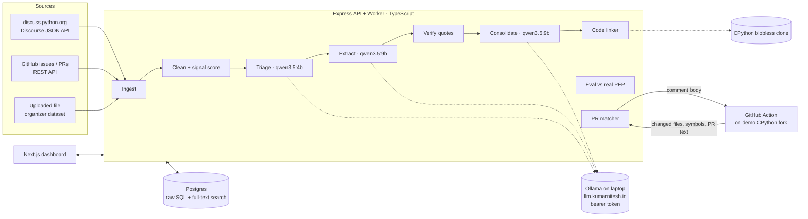

# DejaView — You've Had This Debate Before

> Hacktoberfest Hack Day Sonipat · Problem 06: *Open Source Decision Intelligence and Knowledge Recovery*
> Design document · 31 Oct 2026

---

## 1. The problem, in plain language

Open-source projects make important technical choices **in public conversations** — GitHub issues,
pull-request review threads, forum posts (e.g. discuss.python.org). A single thread can have hundreds of
replies spread over months. Somewhere inside it is the real outcome:

> "We chose **A**. We rejected **B** because it was 2× slower. We rejected **C** because it breaks old code."

That outcome is almost never written down in one clean place. Consequences:

- When experienced contributors leave, the **reasoning leaves with them**.
- Newcomers open PRs that **repeat already-rejected ideas**, and maintainers re-argue the same debate.
- People question a design without knowing **why** it is the way it is.

Python partly solves this with **PEPs** (Python Enhancement Proposals). PEP 1 asks every PEP to include a
**"Rejected Ideas"** section listing what was considered and why it was turned down. Rust has RFCs, Kubernetes
has KEPs, and many teams use **ADRs** (Architecture Decision Records, e.g. the MADR format). But these exist
only for *big* decisions — everyday decisions stay buried.

**Real example.** For Python's `:=` ("walrus") operator (PEP 572), people proposed spelling it `x as y`. It
was rejected because `as` already means different things in `import`, `with` and `except`. That reasoning was
spread across an enormous, heated discussion — heated enough that Python's creator stepped down as BDFL
afterwards.

### What the organizers will test

They give us a **PEP's public discussion without the PEP**. Our system must recover the **ideas that were
rejected and the reasons** — i.e. reconstruct the PEP's "Rejected Ideas" section from the conversation alone.

### What the system must do (from the brief)

| # | Requirement | Where we cover it |
|---|---|---|
| R1 | Analyze discussions, issues, PRs, technical threads | §5.1 Ingest |
| R2 | Extract decisions and their reasoning | §5.2 Extraction funnel |
| R3 | Identify rejected alternatives and why | §5.2 (status = rejected + reasons) |
| R4 | Link decisions to source code | §5.4 Code linking |
| R5 | Keep references to original discussions | §5.3 Verified evidence |
| R6 | Surface decisions when a new PR modifies linked code | §5.5 PR bot |
| R7 | Traceability: maintainers can verify every decision | §5.3 Verified evidence |
| Q1 | Extract from *long* discussions | §5.2 funnel (filter → triage → extract) |
| Q2 | Distinguish accepted vs rejected | §5.2 status + decision-signal scoring |
| Q3 | Stay linked after files are renamed/moved | §5.4 rename-resilient anchors |
| Q4 | Recognize the same contributor across platforms | §5.9 contributor identity (P2) |
| Q5 | Every decision verifiable through its original source | §5.3 quote verification |

---

## 2. Our solution in one line

**DejaView reads old project discussions with a local open-weight LLM, turns them into verified decision
records (decided / rejected / why / sources), links them to the code, and warns contributors on new pull
requests — "you've had this debate before."**

The pitch metaphor: courts don't re-argue settled questions; they **cite precedent**, with a reference to the
original case. DejaView gives codebases the same thing.

### What makes it different from existing tools

| Existing | What it does | Gap we fill |
|---|---|---|
| ADR / MADR / adr-tools | Templates for *manually* writing decision records | Nobody writes them for everyday decisions → we **generate** them, and export to MADR |
| PEPs / RFCs / KEPs | Formal records for big changes | Small decisions stay buried → we mine the discussions |
| Rationale Miner (Sharma et al., ICSE 2021) | Academic heuristics mining rationale from 1.55M Python emails | Research prototype, no code linking, no PR integration → we combine heuristics **+ LLM** and ship a workflow tool |
| Unblocked, Decispher, Memnox, PRBeliefs | Commercial AI context for PR review | Closed, cloud LLMs, private-team focus → we are **open-weight, runs on a laptop, built for public OSS history, every claim verifiable** |

---

## 3. Constraints that shaped the design

| Constraint | Design consequence |
|---|---|
| Open-weight models only (15 pts); naming an unused model = 0 pts and −5 overall | Two Qwen models, **each with a real job** (§6). No embedding model — Postgres full-text search instead. |
| LLM runs on an old gaming laptop (4 GB VRAM, 16 GB RAM) → a few tokens/sec | Never send whole threads to the LLM. **Funnel**: cheap code filters first, small model triages, big model only on what matters. Results are **precomputed**; live runs are a bonus. |
| Organizer CI machines have no API keys / can't reach our LLM | **LLM record/replay**: every LLM call is cached by prompt hash; tests replay recorded responses. CI never needs the LLM. |
| `examples/` must contain real input + real output | Pipeline writes outputs to `examples/` from real runs. |
| 12 hours, 4 people | Monorepo, raw SQL, no queue infra (Postgres-backed job table), tiered features (P0/P1/P2). |
| Judges ask any team member about the code | Small, single-purpose modules; this doc explains each. |
| Repo must start empty; main is PR-only after `HACKATHON.md` | §11 workflow. |
| Every commit message **and** every PR must name the coding agent and the models the project uses (PRs & CI = 10 pts) | Commit-message convention + PR template + a CI check that enforces both (§11). |
| Scored automatically: functional correctness (30), open-source AI use (15), testing & evidence, PRs & CI (10) — "features really built, not stubs" | Every P0 feature has real tests; `examples/` from real runs. |
| Commits after 6:30 AM don't count and may lead to negative marks | Feature freeze 5:30 AM; last merge well before 6:30 AM (§12). |

---

## 4. Architecture



### Components

| Component | Tech | Responsibility |
|---|---|---|
| `apps/web` | Next.js (App Router), TypeScript | Dashboard: search, decision cards, thread timeline, linked code, eval scorecard, ingest form, MADR export |
| `apps/api` | Express, TypeScript, `pg` (raw SQL) | REST API; enqueues jobs; PR-check endpoint |
| `apps/worker` | Node + TypeScript | Polls `jobs` table, runs the pipeline stages, talks to Ollama, runs git commands |
| `packages/core` | TypeScript library | Pure logic shared by api/worker: cleaner, signal scorer, quote verifier, reference parser, PEP parser, matcher, LLM client, prompts, JSON schemas. **Most unit tests live here.** |
| `action/` | GitHub Action (Node 20) | Runs on PRs in the demo repo, sends diff info to the API, posts/updates one PR comment |
| `db/migrations` | Plain `.sql` files | Schema; applied by a tiny migration script (no ORM) |
| `examples/` | JSON + Markdown | Real inputs and real outputs (required by organizers) |

**Hosting:** Postgres + API + worker + web deployed together (e.g. Railway) so the GitHub Action can reach the
API over HTTPS. The LLM stays on the laptop behind `llm.kumarnitesh.in`. Everything also runs locally via
`docker compose` (Postgres) + `npm run dev`.

**Why a Postgres job table instead of Redis/BullMQ:** one less service. Worker claims jobs with
`SELECT … FOR UPDATE SKIP LOCKED`. LLM throughput is the bottleneck, not the queue.

---

## 5. Features

Priority tiers: **P0** = must ship (maps 1:1 to the brief), **P1** = high pitch value, **P2** = only if time remains.

### 5.1 Ingest (P0)

**What:** Load a discussion into the system.

**Inputs supported:**
1. **discuss.python.org thread URL** — Discourse public JSON API: `GET /t/{id}.json` returns the first posts and
   `post_stream.stream` (all post IDs); remaining posts via `GET /t/{id}/posts.json?post_ids[]=…` in batches.
   We store each post's `cooked` HTML and convert to text.
2. **GitHub issue / PR URL** — REST API: issue/PR body, comments, review comments; for PRs also the changed-files list.
   Optional `GITHUB_TOKEN` env var for rate limits (never committed).
3. **File upload** — the organizers' dataset format is unknown in advance, so we accept JSON (array of
   `{author, created_at, body}`), Markdown or plain text (split on post separators). A small adapter per format.

Multiple sources can be grouped under one **topic** (e.g. "PEP 701" = 3 Discourse threads + 2 GitHub issues).

**Leak rule (important for the eval):** ingest and extraction **never read the PEP text itself**. Only the
eval module (§5.6) fetches the PEP, after extraction finishes. We say this explicitly to judges.

**Why judges care:** R1. Works on the organizers' data whatever format it comes in.

### 5.2 Decision extraction — the funnel (P0)

**What:** Turn a long thread into a list of *ideas* with a status and reasons.

```
 300 posts ──► [1 Clean + score]  code, no LLM      ──► ~120 posts
           ──► [2 Triage]         qwen3.5:4b        ──► ~40 relevant posts
           ──► [3 Extract]        qwen3.5:9b        ──► candidate ideas per chunk
           ──► [4 Verify]         code, no LLM      ──► quotes checked ✅/⚠️
           ──► [5 Consolidate]    qwen3.5:9b        ──► final decision records
```

**Stage 1 — Clean + signal score (deterministic).**
- Remove quoted text (Discourse `<aside class="quote">` blocks, GitHub `> ` lines) — replies repeat what they answer.
- Drop near-empty posts ("+1", "thanks", emoji-only) and exact duplicates.
- Compute a `signal_score` per post from:
  - **Decision phrases:** "rejected", "withdrawn", "instead of", "we decided", "I'm -1", "won't work because",
    "the Steering Council", "accepted", "alternative", "why not", "deferred".
  - **Author role:** PEP author(s) (from the thread's first post), Steering Council members, PEP delegate,
    core developers (a small hard-coded list for the demo).
  - **Engagement:** likes, number of replies to the post.
  - **Position:** first post (the proposal) and final posts weighted higher.
- Posts below a threshold are skipped by later stages but kept in the DB (shown greyed out in the timeline).

**Stage 2 — Triage (qwen3.5:4b).** One short prompt per post (or batch of ~5 short posts) →
`{label: proposal | alternative | objection | support | decision | question | noise}`. Small, fast model; the
task is simple classification.

**Stage 3 — Extract (qwen3.5:9b).** Relevant posts are chunked into windows that fit `num_ctx` (target ≤ ~5k
input tokens, overlapping by 2 posts). For each chunk the model returns JSON constrained by Ollama's `format`
(JSON schema):

```json
{
  "ideas": [
    {
      "title": "Spell assignment expressions as `EXPR as NAME`",
      "kind": "alternative",
      "status": "rejected",
      "reasons": ["`as` already has different meanings in import/with/except"],
      "evidence": [
        {"post_id": 4812, "quote": "as already means something different in with and except"}
      ]
    }
  ]
}
```

`status` ∈ `accepted | rejected | withdrawn | open`. The prompt requires: every reason must have at least one
evidence item with a **verbatim** quote ≤ 40 words from a post in the chunk.

**Stage 4 — Verify (deterministic).** For each evidence item: normalize whitespace/case/punctuation, then
fuzzy-match the quote against the cited post (exact substring → score 1.0; otherwise best sliding-window token
similarity). ≥ 0.85 → **verified ✅**; else search the other posts in the chunk (model cited the wrong post) →
re-attach if found; otherwise **unverified ⚠️**. Ideas with zero verified evidence get `confidence = low` and
are visually flagged — never silently dropped.

**Stage 5 — Consolidate (qwen3.5:9b).** Input is small: just titles + reasons of candidate ideas from all chunks.
The model merges duplicates (the same idea discussed in several chunks) and outputs the final list. Merging
unions the evidence. A later "decision" post can override an earlier status (e.g. idea first favored, later
rejected by the SC) — the latest decision-labeled evidence wins, and the record keeps the history.

**How accepted vs rejected is distinguished (Q2):** combination of (a) the model's status with a required
quote, (b) decision-phrase signals, (c) author role (SC / PEP author / delegate statements outweigh others),
(d) recency. The card shows *who* said it and *when*.

**Why judges care:** R2, R3, Q1, Q2. The funnel is explainable in one breath: "cheap filters, small model sorts,
big model reasons, code checks."

### 5.3 Verified evidence & traceability (P0)

**What:** Every decision card shows its sources: each reason → quote → link to the exact post
(`https://discuss.python.org/t/{slug}/{topic}/{post_number}` or GitHub comment URL), author, date, and a
✅ verified / ⚠️ unverified badge.

Plus: every LLM call is stored (`llm_calls` table: model, prompt, response, duration), so a maintainer can
see **exactly what the model was shown and what it said** for any decision.

**Why judges care:** R5, R7, Q5 — and it is our answer to "how do you handle small-model hallucination?":
we don't trust the model, we check it.

### 5.4 Code linking with rename-resilient anchors (P0, rename tracking P1)

**What:** Attach each decision to the CPython files/symbols it is about.

**Link methods (stored as `link_method` with the evidence post):**
1. **Explicit references** in the discussion: `gh-12345`, `bpo-12345`, `python/cpython#12345`, PR URLs, commit
   SHAs → GitHub API → PR's changed files (and merge commit). Strongest link.
2. **Path mentions:** `Lib/asyncio/taskgroups.py`, `Objects/typevarobject.c` → checked to exist in the clone.
3. **Symbol mentions:** backticked identifiers like `` `typing.override` ``, `` `PyErr_SetString` `` → resolved by
   `git grep` for definitions (`def name`, `class name`, C function definitions) in the CPython clone.

**Anchor format:** `(repo, symbol, path_at_link_time, commit_at_link_time)` — **not** line numbers, which change
on every edit.

**Rename resilience (Q3):** when an anchor's path no longer exists at `HEAD`:
1. `git log --follow --name-status --diff-filter=R` from the linked commit → follow the rename chain.
2. If that fails, search for the symbol definition by name across the repo.
3. Update `current_path`, keep the original, record how it was relocated.

**CPython clone:** `git clone --filter=blob:none` (full history, file contents fetched on demand) so
`git log --follow` works without downloading gigabytes.

**Why judges care:** R4, Q3. A concrete answer to "what happens when the file moves?"

### 5.5 PR bot — "DejaView check" (P0)

**What:** A GitHub Action on our **demo fork of CPython** (its own heavy workflows disabled). On `pull_request`:
1. Collect changed files and changed symbols (parse the diff hunks' function/class context lines).
2. `POST /api/pr-check` with `{repo, pr_number, files, symbols, title, body}` (API token from a GitHub secret).
3. API matches against `code_anchors` (path or symbol match, rename-aware) → relevant decisions.
4. Action posts **one** comment (updated in place on new pushes, not spammed):

> **📜 DejaView check — 2 past decisions touch this code**
>
> **PEP 701 · REJECTED: keep f-strings as a special token in the tokenizer**
> Why: nested quotes and backslashes were impossible to support cleanly.
> Evidence: ✅ "…" — @author, discuss.python.org, 2022-12-19 · [view decision](…)
> Linked via: `Lib/tokenize.py` (renamed from …)

The comment is **templated, not LLM-generated** — instant, deterministic, testable.

**Why judges care:** R6. This is the moment in the live demo: open a PR, the bot replies with history.

### 5.6 Self-evaluation scorecard (P1)

**What:** Measures how well we reconstruct a PEP's "Rejected Ideas" from discussion alone — the organizers'
exact test, run on ourselves.

1. Fetch the PEP source from the `python/peps` repo (`peps/pep-NNNN.rst`) — **only after** extraction finished.
2. Parse the ground-truth section(s): "Rejected Ideas", "Rejected Alternatives", "Alternatives" (and similar
   headings); each subsection heading (or bullet) = one ground-truth item with its text.
3. Match each ground-truth item to our extracted ideas: shortlist top-3 candidates by Postgres full-text
   similarity, then qwen3.5:9b judges `{match: yes/no, reason_consistent: yes/partial/no}`.
4. Report per PEP: **recall** (rejected ideas recovered), **reason agreement**, and **extra ideas** (found in the
   discussion but not in the PEP — shown, not counted as wrong, since PEPs don't list everything).

Dashboard shows a side-by-side table: *PEP says* | *DejaView found* | match ✅/❌.

**Why judges care:** proves the system works with a number, and shows we understood how we'll be judged.

### 5.7 "Already rejected?" detector (P1)

**What:** The PR bot also compares the PR title + body (and the ingest of a new issue) against **rejected**
ideas using Postgres full-text search (`ts_rank` over a `tsvector` of title + reasons). Above a threshold:

> ⚠️ This looks similar to a **previously rejected idea**: "…" (PEP 695). Reason: … [sources]

**Why judges care:** directly addresses "new contributors repeat previously rejected approaches."

### 5.8 Dashboard (P0) + MADR export (P1)

**Pages:**
- **Home / search** — full-text search over decisions; filters: status, PEP/topic, has-code-link, verified-only.
- **Topic page** (e.g. PEP 701) — decision list; **thread timeline** showing every post, its triage label,
  signal score, and which posts fed which decision (greyed-out = filtered).
- **Decision card** — title, status badge, reasons, evidence with ✅/⚠️, linked code (with rename history),
  people involved, "view LLM calls" (audit), **Export as MADR**.
- **Ingest** — paste a URL / upload a file → job progress bar (stage-by-stage, since the LLM is slow).
- **Eval scorecard** — per-PEP recall table (§5.6).
- **PR checks** — log of bot comments.

**MADR export:** one Markdown file per decision in MADR layout (Context, Considered Options, Decision Outcome,
Pros/Cons with reasons, Links to sources), or a zip of `docs/decisions/` for a whole topic. Plugs into the
existing ADR ecosystem (adr-tools, log4brains) instead of inventing a format.

### 5.9 Contributor identity across platforms (P2)

**What:** Link a Discourse username, GitHub login and git commit author into one **person**, with a confidence
score and the evidence used:
- exact username match across platforms (medium),
- same display name after normalization (medium),
- Discourse profile linking a GitHub account (high),
- GitHub noreply email / commit email matching a GitHub login (high).

Decision cards then show "decided by *X* — last active in the repo 2023", which ties back to the brief's
"when experienced contributors leave."

### Explicitly out of scope (YAGNI)

- **Chat / "ask why" assistant** — too slow on this hardware; search + decision cards answer the same question.
- **Embedding model / vector DB** — full-text search is good enough and avoids a third model to justify.
- **Live LLM calls during the pitch** — results are precomputed; a live small run is optional.
- **Auth / multi-tenant** — single demo instance; API protected by one token for the Action.

---

## 6. Models

| Model | Where | Job | Why this model |
|---|---|---|---|
| `qwen3.5:4b` | Ollama on team laptop | Stage 2 triage (classify each post) | Simple classification over many posts → speed matters more than depth; fits comfortably in 4 GB VRAM |
| `qwen3.5:9b` | Ollama on team laptop | Stage 3 extraction, stage 5 consolidation, eval matching | Needs reasoning over multi-post context and reliable structured JSON; best quality that runs on our hardware |

**LLM client settings (in `packages/core/llm`):**
- Ollama `/api/chat` at `LLM_BASE_URL` with `Authorization: Bearer $LLM_API_TOKEN` (env only, never committed).
- `format: <JSON schema>` for every call → structured output, no brittle parsing.
- `think: false` (Qwen thinking mode off — big speed win; the funnel does the "thinking" structurally).
- `options: { temperature: 0, num_ctx: 8192 }`.
- Models from env: `TRIAGE_MODEL=qwen3.5:4b`, `EXTRACT_MODEL=qwen3.5:9b`. **Fallback:** if 9B is too slow on
  the day, set `EXTRACT_MODEL=qwen3.5:4b` — both models stay genuinely used.
- `LLM_MODE=live | record | replay`:
  - `live` — call Ollama, cache result.
  - `record` — call Ollama, also write fixture to `fixtures/llm/<sha256(model+prompt+schema)>.json`.
  - `replay` — never call the network; read fixtures; fail loudly if missing. **CI uses this.**
- Cache in `llm_calls` by prompt hash → re-running a pipeline never repeats a finished LLM call (resume after
  laptop crash / network drop).
- Timeouts + 2 retries with backoff; a failed chunk marks the job stage failed but keeps completed chunks.

---

## 7. Data model (Postgres, raw SQL)

```sql
CREATE TABLE topics (           -- a PEP or any decision area
  id            SERIAL PRIMARY KEY,
  slug          TEXT UNIQUE NOT NULL,            -- 'pep-701'
  title         TEXT NOT NULL,
  pep_number    INT,
  created_at    TIMESTAMPTZ DEFAULT now()
);

CREATE TABLE sources (          -- one thread / issue / PR / uploaded file
  id            SERIAL PRIMARY KEY,
  topic_id      INT REFERENCES topics(id),
  kind          TEXT NOT NULL CHECK (kind IN ('discourse','github_issue','github_pr','upload')),
  url           TEXT,
  external_id   TEXT,
  title         TEXT,
  raw           JSONB,
  fetched_at    TIMESTAMPTZ DEFAULT now()
);

CREATE TABLE people (
  id            SERIAL PRIMARY KEY,
  display_name  TEXT NOT NULL
);

CREATE TABLE identities (       -- P2: cross-platform identity
  id            SERIAL PRIMARY KEY,
  person_id     INT REFERENCES people(id),
  platform      TEXT NOT NULL,                   -- 'discourse','github','git'
  handle        TEXT NOT NULL,
  email         TEXT,
  confidence    REAL NOT NULL,
  evidence      TEXT,
  UNIQUE (platform, handle)
);

CREATE TABLE posts (
  id            SERIAL PRIMARY KEY,
  source_id     INT REFERENCES sources(id) ON DELETE CASCADE,
  external_id   TEXT NOT NULL,                   -- Discourse post number / GitHub comment id
  identity_id   INT REFERENCES identities(id),
  author_handle TEXT NOT NULL,
  created_at    TIMESTAMPTZ,
  url           TEXT,
  body_raw      TEXT NOT NULL,
  body_clean    TEXT NOT NULL,                   -- quotes stripped
  signal_score  REAL,
  triage_label  TEXT,                            -- proposal|alternative|objection|support|decision|question|noise
  skipped       BOOLEAN DEFAULT false,
  UNIQUE (source_id, external_id)
);

CREATE TABLE decisions (
  id            SERIAL PRIMARY KEY,
  topic_id      INT REFERENCES topics(id),
  title         TEXT NOT NULL,
  kind          TEXT NOT NULL,                   -- proposal|alternative
  status        TEXT NOT NULL CHECK (status IN ('accepted','rejected','withdrawn','open')),
  summary       TEXT,
  confidence    TEXT NOT NULL CHECK (confidence IN ('high','medium','low')),
  decided_at    TIMESTAMPTZ,
  model         TEXT NOT NULL,                   -- which model produced it
  search        TSVECTOR,                        -- title + summary + reasons
  created_at    TIMESTAMPTZ DEFAULT now()
);
CREATE INDEX decisions_search_idx ON decisions USING GIN (search);

CREATE TABLE reasons (
  id            SERIAL PRIMARY KEY,
  decision_id   INT REFERENCES decisions(id) ON DELETE CASCADE,
  text          TEXT NOT NULL
);

CREATE TABLE evidence (
  id            SERIAL PRIMARY KEY,
  decision_id   INT REFERENCES decisions(id) ON DELETE CASCADE,
  reason_id     INT REFERENCES reasons(id) ON DELETE CASCADE,
  post_id       INT REFERENCES posts(id),
  quote         TEXT NOT NULL,
  verified      BOOLEAN NOT NULL,
  match_score   REAL NOT NULL
);

CREATE TABLE code_anchors (
  id              SERIAL PRIMARY KEY,
  decision_id     INT REFERENCES decisions(id) ON DELETE CASCADE,
  repo            TEXT NOT NULL,                 -- 'python/cpython'
  symbol          TEXT,
  original_path   TEXT NOT NULL,
  original_commit TEXT,
  current_path    TEXT,
  relocated_by    TEXT,                          -- null|'git-follow'|'symbol-search'
  link_method     TEXT NOT NULL CHECK (link_method IN ('pr_ref','path_mention','symbol_mention')),
  evidence_post_id INT REFERENCES posts(id),
  last_checked_at TIMESTAMPTZ
);

CREATE TABLE jobs (
  id            SERIAL PRIMARY KEY,
  type          TEXT NOT NULL,                   -- ingest|extract|link|eval
  payload       JSONB NOT NULL,
  status        TEXT NOT NULL DEFAULT 'queued',  -- queued|running|done|failed
  stage         TEXT,
  progress      REAL DEFAULT 0,
  error         TEXT,
  created_at    TIMESTAMPTZ DEFAULT now(),
  updated_at    TIMESTAMPTZ DEFAULT now()
);

CREATE TABLE llm_calls (        -- audit trail + cache
  id            SERIAL PRIMARY KEY,
  job_id        INT REFERENCES jobs(id),
  prompt_hash   TEXT UNIQUE NOT NULL,
  model         TEXT NOT NULL,
  stage         TEXT NOT NULL,
  prompt        TEXT NOT NULL,
  response      JSONB NOT NULL,
  duration_ms   INT,
  created_at    TIMESTAMPTZ DEFAULT now()
);

CREATE TABLE eval_runs (
  id            SERIAL PRIMARY KEY,
  topic_id      INT REFERENCES topics(id),
  pep_number    INT NOT NULL,
  ground_truth  JSONB NOT NULL,                  -- parsed Rejected Ideas items
  matches       JSONB NOT NULL,                  -- per item: matched decision id, judge verdict
  recall        REAL NOT NULL,
  reason_agreement REAL NOT NULL,
  extra_ideas   INT NOT NULL,
  created_at    TIMESTAMPTZ DEFAULT now()
);

CREATE TABLE pr_checks (
  id            SERIAL PRIMARY KEY,
  repo          TEXT NOT NULL,
  pr_number     INT NOT NULL,
  matched_decision_ids INT[] NOT NULL,
  similar_rejected_ids INT[] NOT NULL,
  comment_body  TEXT NOT NULL,
  created_at    TIMESTAMPTZ DEFAULT now()
);
```

---

## 8. API (Express)

| Method & path | Purpose |
|---|---|
| `POST /api/ingest` | `{url}` or multipart file + `topic` → creates sources, enqueues `ingest` → `extract` → `link` jobs |
| `GET  /api/jobs/:id` | Status, current stage, progress |
| `GET  /api/topics` · `GET /api/topics/:slug` | Topics with decision counts; topic detail |
| `GET  /api/topics/:slug/timeline` | Posts with triage labels, scores, decision links |
| `GET  /api/decisions?q=&status=&topic=&verified=` | Full-text search |
| `GET  /api/decisions/:id` | Card: reasons, evidence, anchors, people |
| `GET  /api/decisions/:id/llm-calls` | Audit trail |
| `GET  /api/decisions/:id/madr` · `GET /api/topics/:slug/madr.zip` | MADR export |
| `POST /api/eval/:slug` · `GET /api/eval` | Run / list eval scorecards |
| `POST /api/pr-check` | Bearer-token protected; returns `{decisions, similarRejected, commentMarkdown}` |
| `GET  /api/health` | Includes LLM reachability (for the demo) |

---

## 9. Testing, CI and evidence (automated score)

**Unit tests (Vitest, `packages/core`)** — no network, no LLM:
- Cleaner: strips Discourse quote blocks and `> ` lines; drops "+1"/thanks posts.
- Signal scorer: decision phrases, author roles, position weighting.
- Reference parser: `gh-`, `bpo-`, `python/cpython#`, PR URLs, SHAs, paths, backticked symbols.
- Quote verifier: exact, fuzzy, wrong-post re-attach, fabricated quote → unverified.
- PEP parser: extracts "Rejected Ideas" items from real PEP `.rst` fixtures.
- Anchor relocation: builds a tiny temporary git repo in the test, renames a file, asserts relocation via
  `git log --follow` and via symbol search.
- PR matcher + comment renderer: snapshot test of the comment Markdown.
- MADR renderer: snapshot test.

**Integration tests:**
- Full pipeline on a real recorded thread with `LLM_MODE=replay` → asserts decisions, statuses, verified
  evidence counts match the recorded run.
- API tests against a Postgres **service container** in GitHub Actions (migrations applied, endpoints hit with supertest).

**CI (`.github/workflows/ci.yml`)** on every PR and on main: `npm ci` → typecheck → lint → migrations on the
Postgres service → `vitest run` with `LLM_MODE=replay`. **No secrets required.**

**`examples/`** (real runs, committed):
```
examples/
  pep-XXX/
    input/        thread.json (the discussion as ingested — no PEP)
    output/       decisions.json, decisions.md (MADR), eval.json (recall vs real PEP)
  pr-check/
    input/        pr.json (changed files + title/body)
    output/       comment.md (the exact comment the bot posts)
  README.md       how each output was produced (command, models, date)
```

**Dev/eval PEP set:** 3 PEPs that (a) have a discuss.python.org thread, (b) have a Rejected Ideas section,
(c) touch CPython code. Candidates to confirm in the first hour: PEP 698 (`typing.override`, small — fast
iteration), PEP 701 (f-string grammar), PEP 695 (type parameter syntax). Swap in the organizers' PEPs as soon
as they provide them.

---

## 10. Live demo script (8 minutes)

1. **(1 min) Problem.** The walrus story: a decision buried in a giant thread; newcomers re-propose `x as y`.
2. **(1 min) Idea.** "DejaView — you've had this debate before." One slide with the funnel.
3. **(2 min) Dashboard.** Open a PEP topic → decision cards → click evidence → lands on the exact
   discuss.python.org post. Show ✅/⚠️ badges and the LLM audit trail.
4. **(1.5 min) PR bot.** Open a prepared PR on the CPython fork touching a linked file → bot comment appears
   with the past decision. Show the "already rejected?" warning on a PR that re-proposes a rejected idea.
5. **(1 min) Scorecard.** "We gave it the discussion without the PEP. It recovered N of M rejected ideas." Side-by-side table.
6. **(0.5 min) Open models.** Qwen3.5 4B + 9B on a 4 GB laptop GPU; why two models.
7. **(1 min) What we learned + trade-offs.**

**Q&A prep (likely questions):**
- *How do you stop hallucinations?* → Verbatim quote required + code verification + unverified badge + audit log.
- *Why not one big model call?* → Context and speed; funnel cuts LLM input ~70–90%.
- *What if the file is renamed?* → Symbol-based anchors + `git log --follow` + symbol search fallback.
- *Did the model see the PEP?* → No. Extraction never reads it; only the eval step does, afterwards.
- *Why Postgres FTS, not embeddings?* → Good enough for titles/reasons, no extra model, explainable ranking.
- *Why is the CI green without the LLM?* → Record/replay fixtures of real calls.

---

## 11. Repo & workflow (hackathon rules)

Source: organizers' *Participant Guidelines* (DevClub) and the Hack Day deck.

1. New empty **public** GitHub repo, **MIT** license. Fresh project — no earlier code.
2. **First commit straight to main:** `HACKATHON.md` (in the organizers' format: team name, team members,
   problem statement, models we use and why), plus `LICENSE` and `.gitignore`.
3. **By 8:30 PM:** first commit pushed, **every member checked in on MLH** (check-in code is in the
   guidelines), and the **team leader submits** the repo on MLH → Challenges → Add Submission → challenge
   *Best Open-Source AI Project* → then Add Member for each teammate.
4. **By 11:00 PM (strict):** team created on **Cadence**. The MLH team and the Cadence team must match; no team switching.
5. After the first commit, **main is PR-only** (branch protection). Every change is a branch + PR; CI runs the
   tests on every PR; merge only when CI passes.
6. **Every commit message and every PR names the coding agent and the project's models.** Commit format:

   ```
   Add quote verifier with fuzzy matching

   Coding agent: Claude Code
   Models used in project: Qwen3.5 9B, Qwen3.5 4B
   ```

   Enforced in two places:
   - `.github/pull_request_template.md` with **Coding agent** and **Models used in project** fields
     (use the organizers' template from the Problem Statements doc if it differs).
   - A CI job (`.github/workflows/conventions.yml`) that fails a PR if any commit message in it lacks the
     `Coding agent:` and `Models used in project:` lines, or if the PR body lacks the models section.
   - Optional local helper: a `commit-msg` git hook (via `npm run setup-hooks`) that appends the two lines
     when missing.
7. No secrets ever: `LLM_API_TOKEN`, `GITHUB_TOKEN`, `DEJAVIEW_API_TOKEN` only in `.env` (listed in
   `.gitignore`) and deployment/GitHub secrets. Commit a `.env.example` with empty values.
8. Required in the repo: `HACKATHON.md`, real tests, a GitHub Actions CI workflow that installs the project
   and runs the tests (must pass on the **last commit**), and an `examples/` folder with real input/output.
9. **Final push by 6:30 AM.** Commits after 6:30 AM don't count and may lead to negative marks.
10. This `design.md` goes into the repo via the first PR after the init commit.

---

## 12. Team split (4 people) and timeline

| Person | Owns |
|---|---|
| **A — Data & API** | Repo setup, migrations, Express API, job table + worker loop, ingest (Discourse, GitHub, upload), deployment |
| **B — LLM pipeline** | LLM client (record/replay, cache), prompts + JSON schemas, cleaner/scorer, triage/extract/verify/consolidate, eval scorecard |
| **C — Code & GitHub** | CPython blobless clone, reference parser, code linker + rename relocation, PR matcher, GitHub Action, demo fork + demo PRs |
| **D — Frontend & pitch** | Next.js dashboard (all pages), MADR export UI, `examples/` README, slides, demo script, blog (optional) |

| Time | Milestone |
|---|---|
| 6:30–8:30 PM | Repo + `HACKATHON.md` + LICENSE + `.gitignore` first commit; **all members MLH check-in; leader submits repo on MLH**; then PR #1: PR template + CI skeleton + conventions check + `design.md`; schema; pick 3 dev PEPs; start pulling Qwen models |
| 8:30–11:00 PM | **Team on Cadence by 11 PM (strict)**; ingest working end-to-end; LLM client + triage; dashboard skeleton reading real API; reference parser |
| 11 PM–2 AM | Extract + verify + consolidate on PEP #1; code linking; decision card UI; **start long LLM runs on all 3 PEPs** |
| 2–4 AM | PR bot end-to-end on the fork; eval scorecard; record fixtures; integration tests green |
| 4–5:30 AM | P1 polish (already-rejected detector, rename demo, MADR); `examples/` from real runs; run organizer PEPs |
| 5:30–6:30 AM | Freeze features; CI green on main; final merge; rehearse the demo |

---

## 13. Risks & mitigations

| Risk | Mitigation |
|---|---|
| LLM too slow for all PEPs | Funnel; precompute overnight; `EXTRACT_MODEL` → 4B; prioritize organizer PEPs |
| Laptop / tunnel down during the pitch | Everything precomputed in Postgres; dashboard and PR bot don't need the LLM |
| Small model returns bad JSON | Ollama `format` schema constraint + schema validation (zod) + 2 retries |
| Model invents quotes | Verifier marks them ⚠️; low-confidence ideas flagged |
| Organizer data format unknown | Upload adapters (JSON / Markdown / text); adapt in minutes |
| CPython repo is huge | Blobless clone; only resolve paths/symbols that are referenced |
| GitHub API rate limits | Optional token via env; cache fetched sources in `sources.raw` |
| CI can't reach LLM | `LLM_MODE=replay` with committed fixtures |

---

## 14. References

- Problem 06 statement and Hack Day rules deck (Hacktoberfest HackDay Sonipat).
- PEP 1 (Rejected Ideas guidance), PEP 9 / PEP 12 (PEP templates) — peps.python.org.
- Sharma, Savarimuthu, Stanger. *Extracting Rationale for Open Source Software Development Decisions — A Study
  of Python Email Archives.* ICSE 2021. arXiv:2102.05232.
- Architecture Decision Records (Nygard), MADR, adr-tools.
- Discourse API (discuss.python.org), GitHub REST API, Ollama API (structured outputs via `format`).
- Related products: Unblocked, Decispher, Memnox, PRBeliefs.
