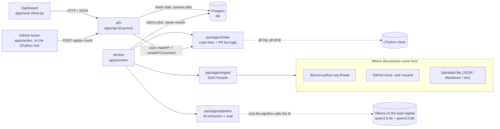

# DejaView: the platform guide

> "You've had this debate before."
>
> This guide explains **what DejaView is, what it does, why it is built this way, and how the code does
> it**, in plain words, with links to the real files. It covers everything in [`design.md`](../design.md)
> (the problem, the features, the design choices, the hackathon rules and scoring), so **you don't need to
> read `design.md` to understand the project**. If the two ever disagree, `design.md` is the official
> version and this file should be fixed.
>
> - Who owns which folder: [`docs/team/README.md`](team/README.md).
> - This file describes the code **as it is in the repo** (status checked on 31 Oct 2026, around midnight).
>   Section 12 says what is finished and what is still missing.

---

## Contents

1. [The problem in one minute](#1-the-problem-in-one-minute)
2. [What DejaView does](#2-what-dejaview-does) (and how it differs from existing tools, and the brief's checklist)
3. [Who uses it, and how](#3-who-uses-it-and-how)
4. [The big picture](#4-the-big-picture) (and the design choices behind it)
5. [The features, one by one](#5-the-features-one-by-one)
6. [The life of one discussion, step by step](#6-the-life-of-one-discussion-step-by-step)
7. [A tour of the folders](#7-a-tour-of-the-folders)
8. [The data: the contract and the database](#8-the-data-the-contract-and-the-database)
9. [The AI part](#9-the-ai-part)
10. [Running it on your laptop](#10-running-it-on-your-laptop)
11. [Tests, CI and the repo rules](#11-tests-ci-and-the-repo-rules)
12. [What is done and what is missing](#12-what-is-done-and-what-is-missing)
13. [The hackathon: scoring, timeline, team, demo](#13-the-hackathon-scoring-timeline-team-demo)
14. [Risks and what we do about them](#14-risks-and-what-we-do-about-them)
15. [Words you will hear](#15-words-you-will-hear)
16. [Questions judges may ask](#16-questions-judges-may-ask)
17. [References](#17-references)

---

## Before the pitch and viva: what to read

Judges can ask **any** member about **any** code. You don't need to read the whole repo. Read in this order:

**1. Everyone, this guide (about 30 minutes).** Most important sections: 2 (what it does + the brief's
checklist), 4 (big picture and why), 5 (features), 6 (the life of one discussion), 9 (the AI part), 16
(likely questions).

**2. Everyone, these 10 files (about 1 hour).** Together they cover the whole flow; skim the rest.

| # | File | What it teaches you |
|---|---|---|
| 1 | [`HACKATHON.md`](../HACKATHON.md) | The two models and why: the first thing judges check |
| 2 | [`packages/shared/src/domain.ts`](../packages/shared/src/domain.ts) | The shapes passed between parts: Thread, decision, reason, evidence, anchor |
| 3 | [`packages/shared/src/api.ts`](../packages/shared/src/api.ts) | Every API route and what it returns |
| 4 | [`db/migrations/001_init.sql`](../db/migrations/001_init.sql) | The database tables |
| 5 | [`apps/worker/src/handlers.ts`](../apps/worker/src/handlers.ts) | The job chain: ingest → extract → link, and eval |
| 6 | [`db/src/jobs.ts`](../db/src/jobs.ts) | The job queue: `SKIP LOCKED`, lease, attempt number (the comment at the top is enough) |
| 7 | [`packages/pipeline/src/llm/client.ts`](../packages/pipeline/src/llm/client.ts) | How every AI call works: cache, record/replay, JSON schema, retries |
| 8 | [`packages/linker/src/link-decision.ts`](../packages/linker/src/link-decision.ts) | How a decision gets linked to code (PR refs, paths, symbols) |
| 9 | [`apps/api/src/routes/prChecks.ts`](../apps/api/src/routes/prChecks.ts) + [`packages/linker/src/pr.ts`](../packages/linker/src/pr.ts) | What happens when the PR bot calls us, and how the comment is built |
| 10 | [`apps/web/src/app/decisions/[id]/page.tsx`](../apps/web/src/app/decisions/[id]/page.tsx) | The decision card: where evidence, code links and the audit trail come together |

| 11 | [`packages/pipeline/src/run-extraction.ts`](../packages/pipeline/src/run-extraction.ts) | The whole AI funnel in one function: clean → triage → extract → verify → consolidate |
| 12 | [`packages/pipeline/src/verify.ts`](../packages/pipeline/src/verify.ts) | How every quote is checked: the answer to "how do you stop hallucinations?", the most likely question |
| 13 | [`packages/pipeline/src/eval/evaluate.ts`](../packages/pipeline/src/eval/evaluate.ts) | How the scorecard numbers are computed |

**3. Your own part, in depth.** Know every file in the folders you own (section 13, "Who does what"),
including the tests: be able to say what each one checks.

**4. Practise out loud.** Explain section 6 (the life of one discussion) in two minutes without notes, and
answer every question in section 16.

---

## 1. The problem in one minute

Open-source projects decide things **in public conversations**: forum threads, GitHub issues, pull-request
reviews. One thread can have hundreds of replies over months. Somewhere inside it is the real answer:

> "We chose **A**. We rejected **B** because it was 2× slower. We rejected **C** because it breaks old code."

Nobody writes that answer down in one clean place. So:

- when experienced people leave, **the reasons leave with them**;
- newcomers open pull requests that **repeat ideas that were already rejected**;
- people question a design without knowing **why** it is that way.

Python has a partial fix: **PEPs** (Python Enhancement Proposals). PEP 1 asks every PEP to have a
**"Rejected Ideas"** section listing what was considered and why it was turned down. Rust has RFCs,
Kubernetes has KEPs, and many teams write **ADRs** (Architecture Decision Records, for example in the MADR
format). But only big changes get one. Everyday decisions stay buried in threads.

**A real example.** For Python's `:=` ("walrus") operator (PEP 572), people proposed writing it as `x as y`.
That was rejected because `as` already means different things in `import`, `with` and `except`. The reason
was spread across an enormous, heated discussion, heated enough that Python's creator stepped down as its
leader (BDFL) afterwards. Today a newcomer could propose `x as y` again without ever finding that reason.

**The hackathon test (Problem 06):** the organizers give us a PEP's discussion **without the PEP**. Our
system must find the ideas that were rejected and the reasons, i.e. rebuild the PEP's "Rejected Ideas"
section from the conversation alone. Section 2.2 lists everything the brief asks for; the word-for-word brief is in [`design.md` Appendix A](../design.md).

---

## 2. What DejaView does

**DejaView reads old project discussions with a small open-source AI model that runs on our own laptop,
turns them into decision records you can check, links those records to the code they are about, and warns
contributors when a new pull request touches that code.**

A **decision record** answers four questions:

| Question | Example |
|---|---|
| What was the idea? | "Check `@override` at runtime" |
| What happened to it? | **Rejected** (other statuses: accepted, withdrawn, open) |
| Why? | "It would slow down every class creation" |
| Where is the proof? | A **verbatim quote** from the thread, with the author, the date and a link to the exact post |

Think of a court: judges do not re-argue settled questions, they **cite precedent**. DejaView gives a
codebase the same thing.

Three ideas make it trustworthy:

1. **We don't trust the AI, we check it.** The model must quote the thread word for word. Code (not AI)
   then checks every quote against the real post and marks it ✅ verified or ⚠️ unverified. Unverified
   quotes are **shown**, never hidden, so a person can judge.
2. **Everything links back to the source.** Every reason has a link to the post it came from, and every
   model call is saved (what the model was shown, what it answered).
3. **It runs on open models on a laptop.** Two Qwen models through Ollama. No paid or closed AI.

### 2.1 How it differs from what already exists

| Existing | What it does | What DejaView adds |
|---|---|---|
| ADR / MADR / adr-tools | Templates for people to write decision records **by hand** | Nobody writes them for everyday decisions, so we **generate** them from discussions, and export to MADR so they plug into the same tools |
| PEPs / RFCs / KEPs | Formal records for big changes | Small decisions stay buried; we dig them out of the threads |
| Rationale Miner (Sharma et al., ICSE 2021) | Research that found decision reasons in 1.55M Python emails using rules | A research prototype with no code linking and no PR integration; we combine rules **and** an AI model, and ship a working tool |
| Unblocked, Decispher, Memnox, PRBeliefs | Commercial AI context for code review | Closed, cloud AI, aimed at private teams; we are **open-model, run on a laptop, built for public open-source history, and every claim can be checked** |

### 2.2 What the brief asks for, and where we cover it

The organizers' brief lists seven things the system must do (R) and five hard questions (Q). Every one maps
to a feature in section 5:

| # | The brief asks | Where we answer it |
|---|---|---|
| R1 | Analyze discussions, issues, PRs, technical threads | 5.1 Ingest |
| R2 | Extract decisions and their reasoning | 5.2 Extraction funnel |
| R3 | Identify rejected alternatives and why | 5.2 (status = rejected, plus reasons) |
| R4 | Link decisions to source code | 5.4 Code linking |
| R5 | Keep references to the original discussions | 5.3 Verified evidence |
| R6 | Surface decisions when a new PR changes linked code | 5.5 PR bot |
| R7 | Traceability: maintainers can verify every decision | 5.3 Verified evidence + audit trail |
| Q1 | How to extract from **long** discussions? | 5.2 the funnel (filter → triage → extract) |
| Q2 | How to tell accepted from rejected? | 5.2 status with a required quote + decision phrases + who said it + when |
| Q3 | How to stay linked after files are renamed or moved? | 5.4 anchors by symbol + path + commit, rename tracking |
| Q4 | How to recognize the same person across platforms? | 5.9 (planned, lowest priority) |
| Q5 | How to keep every decision verifiable through its source? | 5.3 quote checking + links to the exact post |

---

## 3. Who uses it, and how

| Who | What they do with DejaView | Where |
|---|---|---|
| **Maintainer** (someone who looks after the project) | Searches past decisions, opens a decision card, clicks a quote to land on the original post, exports a decision as a Markdown file for the project's docs | Dashboard (`apps/web`) |
| **Contributor** (someone opening a pull request) | Opens a PR on the repo. The DejaView bot comments: "these past decisions touch this code" or "this looks like an idea that was rejected before" | GitHub Action (`apps/action`) |
| **Team / judges** | Ingest a new discussion (paste a link or upload a file), watch it being processed, and see the **scorecard**: how many of the PEP's rejected ideas we recovered | Dashboard: Ingest and Evaluation pages |

The demo repo is a **fork of CPython** (Python's own source code), because PEPs are about CPython.

---

## 4. The big picture



How to read it:

- **The API never does slow work.** It reads the database and puts **jobs** in a queue. The **worker** picks
  up jobs and does the slow parts (fetching threads, running the AI, linking code).
- **Libraries vs apps.** `packages/*` are libraries: plain functions, no database, no web server, so they are
  easy to test with fixture files. `apps/*` are programs that run. `db/` is the only code that talks to
  Postgres.
- **One shared contract.** Every part talks to every other part through TypeScript types in
  [`packages/shared`](../packages/shared/src). That is how four people could build at the same time.
- **The AI is only used offline, by the worker.** The dashboard and the PR bot read results from Postgres.
  If the laptop running the AI is switched off, the demo still works.

An animated version of this flow, built from the real running system, is in
[`docs/team/dejaview-flow.gif`](team/dejaview-flow.gif) (made by `npm run render-flow -w @dejaview/api`).

### 4.1 Why it is built this way

Every big choice comes from a limit we had to live with:

| The limit | What we did about it |
|---|---|
| Only open models are allowed (15 points), and naming a model the code doesn't use gives 0 points and −5 overall | Two Qwen models, **each with a real job** (section 9). No embedding model; Postgres full-text search instead |
| The AI runs on an old gaming laptop (4 GB GPU, 16 GB RAM): a few words per second | Never send a whole thread. The **funnel**: code filters first, small model sorts, big model only on what matters. Results are **computed ahead of time**; live runs are a bonus |
| The organizers' test machines have no API keys and can't reach our laptop | **Record / replay**: every AI answer is saved by prompt hash; tests replay the saved answers, so CI never needs the AI |
| `examples/` must contain real input and real output | The pipeline writes its outputs to `examples/` from real runs; nothing hand-written |
| 12 hours, 4 people | One repo with workspaces, raw SQL (no ORM), a job queue in Postgres (no Redis), features in priority tiers |
| Judges can ask any team member about any code | Small modules that each do one thing, plain names, comments that say *why* |
| Every commit and PR must name the coding agent and the models (PRs and CI = 10 points) | A commit-message rule, a PR template, and a CI check that enforces both |
| Points for "features really built, not stubs" and for tests | Every feature ships with real tests |
| Commits after 6:30 AM don't count and may cost marks | Feature freeze at 5:30 AM, last merge well before 6:30 |

**Why a job table in Postgres instead of Redis or a queue service?** One less thing to run. The bottleneck is
the AI's speed, not the queue.

**Priority tiers** used for planning: **P0** = must ship (maps directly to the brief: ingest, extraction,
evidence, code linking, PR bot, dashboard), **P1** = high value for the pitch (evaluation scorecard,
"already rejected?" detector, rename tracking, MADR export), **P2** = only if time is left (same person
across platforms).

**Left out on purpose:**
- **A chat assistant** ("ask why…"): too slow on this hardware; search and decision cards answer the same question.
- **An embedding model / vector database**: full-text search is good enough and avoids a third model to justify.
- **Live AI calls during the pitch**: results are precomputed; a small live run is optional.
- **Logins and multiple users**: one demo instance; only the PR-check endpoint is protected, with one token.

---

## 5. The features, one by one

Status key: ✅ built and tested · 🟡 partly built · ⬜ not built yet (see section 12).

### 5.1 Ingest: load a discussion ✅

**What it does.** Takes a link or a file and turns it into one standard shape, a `Thread` (a topic, a source,
and a list of posts).

**Three ways in:**

| Input | How | File |
|---|---|---|
| discuss.python.org link | Discourse's public JSON API. `/t/{id}.json` gives the first ~20 posts and the ids of all posts; the rest come in batches from `/t/{id}/posts.json` | [`packages/ingest/src/discourse.ts`](../packages/ingest/src/discourse.ts) |
| GitHub issue or PR link | GitHub REST API: the body, the comments, review comments, and for PRs the changed files. `GITHUB_TOKEN` is optional (raises the rate limit) | [`packages/ingest/src/github.ts`](../packages/ingest/src/github.ts) |
| Uploaded file | Because we don't know the organizers' format in advance: a JSON array of posts, or Markdown / plain text where posts are separated by a line of `---` and start with `Author: name` (or `**name**`, `@name`) | [`packages/ingest/src/upload.ts`](../packages/ingest/src/upload.ts) |

- [`url.ts`](../packages/ingest/src/url.ts) works out which kind of link was pasted.
- [`http.ts`](../packages/ingest/src/http.ts) is the one place that touches the network, so tests can swap in
  a fake.
- [`cli.ts`](../packages/ingest/src/cli.ts) is a command line tool that saves a thread as a fixture file:
  `npm run fetch-thread -w @dejaview/ingest -- <url-or-file> --slug pep-701 --pep 701`. The real threads for
  PEP 695 (140 posts), PEP 698 (11 posts) and PEP 701 (114 posts) are in [`fixtures/threads/`](../fixtures/threads).

One **topic** can hold several sources, for example "PEP 701" = three forum threads + two GitHub issues.

**The leak rule.** Ingest and extraction **never read the PEP itself**. Only the evaluation step (5.6)
downloads the PEP, after extraction is finished. This keeps the test honest.

### 5.2 Decision extraction: the funnel ✅

**What it does.** Turns a long thread into a short list of ideas, each with a status and reasons.

A 300-post thread is far too big and slow for a laptop model, so we use a **funnel**: cheap code first, the
small model next, the big model only on what matters.

```
 300 posts ─► 1. Clean + score    code, no AI       ─► ~120 posts   (drop quotes, "+1", "thanks")
           ─► 2. Triage          qwen3.5:4b         ─► ~40 posts    (label each post)
           ─► 3. Extract         qwen3.5:9b         ─► ideas per chunk, with quotes
           ─► 4. Verify          code, no AI        ─► every quote checked ✅ / ⚠️
           ─► 5. Consolidate     qwen3.5:9b         ─► final list, duplicates merged
```

1. **Clean + score.** Remove quoted text (replies repeat what they answer), drop empty posts, and give each
   post a **signal score**: phrases like "rejected", "instead of", "we decided", who wrote it (PEP author,
   Steering Council, core developer), likes, and position (first and last posts matter more). Low-score
   posts are skipped but kept, and shown greyed out in the dashboard timeline.
2. **Triage (4B model).** Label each post: `proposal`, `alternative`, `objection`, `support`, `decision`,
   `question` or `noise`.
3. **Extract (9B model).** The useful posts are cut into chunks that fit the model (about 5,000 words of
   input at most, each chunk overlapping the next by 2 posts so nothing is cut in half). For each chunk the
   model returns JSON, forced into shape by a JSON schema:

   ```json
   {
     "ideas": [
       {
         "title": "Spell assignment expressions as `EXPR as NAME`",
         "kind": "alternative",
         "status": "rejected",
         "reasons": ["`as` already has different meanings in import/with/except"],
         "evidence": [
           { "post_id": 4812, "quote": "as already means something different in with and except" }
         ]
       }
     ]
   }
   ```

   `status` is one of `accepted`, `rejected`, `withdrawn`, `open`. The prompt requires at least one
   **word-for-word quote of at most 40 words** for every reason, from a post in that chunk.
4. **Verify (code).** Each quote is compared with the real post after ignoring differences in spaces,
   capitals and punctuation: an exact match scores 1.0, otherwise the best matching window of words gives a
   similarity score. Score ≥ 0.85 → ✅ verified. If the model cited the wrong post, we look in the other posts and fix the link. Otherwise ⚠️
   unverified. Ideas with no verified quote get **low confidence**, and are flagged, not dropped.
5. **Consolidate (9B model).** The same idea often appears in several chunks. The model gets only the
   titles and reasons (a small input), merges duplicates, and all their quotes are kept together. A later
   "decision" post can change an earlier status (for example, an idea liked at first and rejected by the
   Steering Council later): the latest decision wins, and the record keeps the history.

**How accepted and rejected are told apart (Q2):** the model's status, which must come with a quote; decision
phrases in the post; **who** said it (Steering Council, PEP author or PEP delegate outweigh others); and
**when** (later beats earlier). The card shows who said it and when, so a reader can judge.

**Why this shape:** you can explain the funnel in one breath: "cheap filters, the small model sorts, the big
model reasons, code checks."

**Where** ([`packages/pipeline/src/`](../packages/pipeline/src), one small file per stage):

| Stage | File | Model | What the code does |
|---|---|---|---|
| 1a. Clean | [`clean.ts`](../packages/pipeline/src/clean.ts) + [`text.ts`](../packages/pipeline/src/text.ts) | none | HTML → text, removes quoted replies (`<aside class="quote">`, `<blockquote>`, `> ` lines), skips empty / "+1" / "thanks" / under-5-word / duplicate posts |
| 1b. Score | [`score.ts`](../packages/pipeline/src/score.ts) | none | Signal score from decision phrases, proposer, Steering Council / core devs, likes, position, length. A post scoring below 1 is skipped |
| 2. Triage | [`triage.ts`](../packages/pipeline/src/triage.ts) | 4B | 5 posts per call, one label each; the prompt has 4 examples (including "I am -1 on this, it breaks old code" → objection, which the 4B got wrong without them). A `noise` label only removes posts under 40 words (`reachesExtraction`): on the real PEP 698 run the 4B called the PEP author's 500-word reply about the Rejected Alternatives "noise". A post the model forgets is kept |
| 3. Extract | [`chunk.ts`](../packages/pipeline/src/chunk.ts) + [`extract.ts`](../packages/pipeline/src/extract.ts) | 9B | Windows of about 3,500 tokens of posts, overlapping by 3 posts; each post shown as `[post id] author (date)`, cut at 6,000 characters; the rules are repeated after the posts. The answer is kept small (prompt **and** JSON schema): at most 5 ideas per chunk (most important first), 2 reasons each, 1 quote of at most 25 words per reason, because on PEP 701 an uncapped answer ran past 2,500 tokens. A chunk that fails is skipped (the run fails only if every chunk fails) |
| 4. Verify | [`verify.ts`](../packages/pipeline/src/verify.ts) | none | Exact match = 1.0, else best window of words; ≥ 0.85 verified; wrong post → re-attached; otherwise kept as unverified |
| 5. Consolidate | [`consolidate.ts`](../packages/pipeline/src/consolidate.ts) | 9B | Only titles + reasons go in; the model groups duplicates; code makes sure every idea lands in exactly one group, then merges reasons and quotes. Skipped when there is only one idea |
| All | [`run-extraction.ts`](../packages/pipeline/src/run-extraction.ts) | | `runExtraction(thread, { llmStore, onProgress })` runs 1→5, reports each stage for the progress bar, gives keys `d1, d2…`, sets confidence (high = all quotes verified and ≥ 2; low = none verified), `decidedAt` = date of the latest quoted post |

**Made for a slow laptop** (lessons from the first real runs): answers stream (no Cloudflare 524), each call
may take up to 15 minutes, an answer is capped at 2,500 tokens (`num_predict`) so a model stuck repeating
itself stops, an answer cut off for length is not retried (at temperature 0 the retry would be identical),
and a recorded answer in `fixtures/llm/` is reused even in live mode, so the worker re-processing a thread
we already ran answers in seconds.

Every model call goes through [`llm/ask.ts`](../packages/pipeline/src/llm/ask.ts), a thin wrapper over the
AI client ([`client.ts`](../packages/pipeline/src/llm/client.ts), section 9), so the stages can be tested
with a fake model. Models come from [`config.ts`](../packages/pipeline/src/config.ts) (`TRIAGE_MODEL`,
`EXTRACT_MODEL`).

**The context window (8,192 tokens) and why we chunk.** Measured on our threads: PEP 698's whole
discussion is about 1,300 tokens after cleaning, so it goes to the 9B in one call. PEP 701 (~20,000
tokens) and PEP 695 (~28,000) don't fit, so they are split into chunks. We keep `num_ctx` at 8,192 instead
of raising it: the 9B barely fits the 4 GB GPU, a bigger window is slower and uses more memory, and small
models lose track of the middle of long inputs. To make chunking safe:
- each chunk is ~3,500 tokens of posts + ~400 of instructions, leaving ~2,000 for the answer;
- the rules are repeated after the posts, because Ollama silently drops the *start* of a prompt that is too long;
- the client reads Ollama's real token count from the stream and warns when a prompt nears the window or an
  answer was cut off (`contextWarning` in [`llm/client.ts`](../packages/pipeline/src/llm/client.ts));
- chunks overlap by 3 posts, and consolidation merges an idea seen in several chunks (a later "decision" post wins the status).

**Run it yourself** on a saved thread (writes the real outputs to `examples/<slug>/`, caches model answers
in `data/llm-cache/` so a crashed run resumes):

```sh
npm run extract -w @dejaview/pipeline -- fixtures/threads/pep-698.json --eval
# LLM_MODE=record also saves every answer to fixtures/llm/ so tests can replay it
```

### 5.3 Verified evidence and the audit trail ✅ (storage and display)

**What it does.** Every decision card shows: reason → quote → author, date, link to the exact post, and a ✅
or ⚠️ badge. Every model call is saved in the `llm_calls` table (model, stage, prompt, response, time taken),
and linked to the decisions it produced, so a maintainer can see **exactly what the model was shown and
what it said**.

**Where.** Storage: [`db/src/decisions.ts`](../db/src/decisions.ts), [`db/src/llmCalls.ts`](../db/src/llmCalls.ts).
API: `GET /api/decisions/:id` and `GET /api/decisions/:id/llm-calls`. Display:
[`apps/web/src/components/decision/`](../apps/web/src/components/decision) (`EvidenceQuote.tsx`,
`ReasonList.tsx`, `AuditDrawer.tsx`).

### 5.4 Code linking that survives renames ✅

**What it does.** Attaches each decision to the CPython files and functions it is about.

The linker only looks at the posts a decision **quotes** (and their direct replies), and finds references
in them ([`references.ts`](../packages/linker/src/references.ts)): `gh-12345`, `bpo-12345`, GitHub PR/issue
links, `python/cpython#123`, commit hashes, file paths like `Lib/typing.py`, and code names like
`` `typing.override` ``.

Then [`link-decision.ts`](../packages/linker/src/link-decision.ts) turns them into **anchors**, strongest first:

| Link method | How | Strength |
|---|---|---|
| `pr_ref` | A referenced pull request → ask GitHub for its changed files ([`github.ts`](../packages/linker/src/github.ts)) | Strongest |
| `path_mention` | A file path mentioned in the post, **only if it exists** in the CPython clone | Medium |
| `symbol_mention` | A code name, **only if `git grep` finds its definition** (`def`, `class`, C function) ([`cpython.ts`](../packages/linker/src/cpython.ts)) | Supporting |

**An anchor is not a line number.** It is `(repo, symbol, path, commit)`. Line numbers change on every edit;
these don't.

**Renames.** If a file was moved later, [`relocate-anchor.ts`](../packages/linker/src/relocate-anchor.ts)
follows git's rename history (`git log --follow`), or, if that fails, searches for the symbol's definition.
It keeps the original path and records how it found the new one (`git-follow` or `symbol-search`). The
dashboard shows "renamed from …".

The CPython clone is **blobless** (`git clone --filter=blob:none`): full history, file contents downloaded
only when needed, so it doesn't take gigabytes.

**Wired into the worker** ([`apps/worker/src/cpython.ts`](../apps/worker/src/cpython.ts),
[`handlers.ts`](../apps/worker/src/handlers.ts)): before the first link job the worker makes sure the
blobless CPython clone exists (`CPYTHON_DIR`, default `data/cpython`, git-ignored), and every anchor from
`linkDecision` goes through `relocateAnchor` before it is saved, so `current_path` and `relocated_by` are
filled in.

### 5.5 The PR bot: "DejaView check" ✅ (code), 🟡 (fork not set up yet)

**What it does.** When someone opens or updates a pull request on our CPython fork, a GitHub Action:

1. reads the PR title, description and changed files (including renames), and picks out the changed
   functions and classes from the diff ([`extractSymbolsFromPatches`](../apps/action/src/action.ts));
2. sends them to `POST /api/pr-check` with a secret token;
3. posts **one** comment on the PR, and **updates** the same comment on later pushes instead of adding new ones.
   It finds its own comment by a hidden marker, `<!-- dejaview -->`.

On the API side ([`apps/api/src/routes/prChecks.ts`](../apps/api/src/routes/prChecks.ts)):

- **related decisions** come from the linker's `matchPr` ([`packages/linker/src/pr.ts`](../packages/linker/src/pr.ts)):
  accepted decisions whose code the PR touches (path or symbol), and rejected decisions whose words look
  like the PR's proposal;
- **similar rejected ideas** come from Postgres full-text search on the PR's title and description;
- `renderPrComment` turns them into Markdown. The comment is a **template, not AI-written**: instant, the
  same every time, and testable. It looks like this:

  > **📜 DejaView check — 2 past decisions touch this code or proposal**
  >
  > Historical context is informational; it does not automatically reject this pull request.
  >
  > ### Related accepted architectural decisions
  > **PEP 698 · ACCEPTED: Add an `@override` decorator to `typing`** ([view decision](…))
  > Why: it costs nothing at runtime beyond setting one attribute.
  > Linked via: `Lib/typing.py`
  >
  > ### Previously rejected similar proposals
  > **PEP 698 · REJECTED: Enforce `@override` at runtime** ([view decision](…))
  > Why: walking the class hierarchy for every decorated method slows down class creation.

  (Example wording. The real comment uses the decisions in the database.)
- the check is saved in `pr_checks`, and the dashboard's PR checks page shows it.

The Action's setup steps for the fork are in [`apps/action/README.md`](../apps/action/README.md), and the
workflow file to copy into the fork is [`apps/action/workflows/dejaview.yml`](../apps/action/workflows/dejaview.yml).
A real (no-match) example request and comment are in [`examples/pr-check/`](../examples/pr-check).

### 5.6 Self-evaluation scorecard ✅

**What it does.** Runs the organizers' test on ourselves, so we can show a number instead of a promise:

1. **Only after extraction has finished**, download the PEP's source from the `python/peps` repository
   (`peps/pep-NNNN.rst`).
2. Read its "Rejected Ideas" section (also "Rejected Alternatives", "Alternatives" and similar headings).
   Each sub-heading or bullet is one **ground-truth** idea, with its text.
3. For each ground-truth idea, shortlist our 3 closest decisions with Postgres full-text search, then ask
   the 9B model to judge: "is this the same idea? (yes / no)" and "do the reasons agree? (yes / partly / no)".

It reports per PEP:
- **recall**: share of the PEP's rejected ideas we recovered;
- **reason agreement**: for those we found, do our reasons match the PEP's;
- **extra ideas**: rejected ideas we found that the PEP doesn't list (shown, not counted as wrong).

**Where.**
- [`packages/pipeline/src/eval/pep.ts`](../packages/pipeline/src/eval/pep.ts): downloads the PEP and reads
  its rejected-ideas sections. It understands both PEP styles: one sub-heading per idea (PEP 698, PEP 695)
  and numbered `#.` lists (PEP 701). Tested on the real PEP files saved in
  [`packages/pipeline/tests/fixtures/peps/`](../packages/pipeline/tests/fixtures/peps).
- [`packages/pipeline/src/eval/evaluate.ts`](../packages/pipeline/src/eval/evaluate.ts): `evaluatePep()`.
  The shortlist is pure code (shared meaningful words, no database). One 9B call per ground-truth idea
  answers `{best, reasons_agree}`; an answer out of range counts as "no match". Reason agreement scores
  yes = 1, partly = 0.5, no = 0.
- The dashboard page ([`apps/web/src/app/eval/page.tsx`](../apps/web/src/app/eval/page.tsx)) with its
  "Run evaluation" button, the API (`POST /api/eval/:slug`, `GET /api/eval`), the worker's `eval` job and
  the `eval_runs` table (which turns each match's `d1` key into the real decision id).

### 5.7 "Already rejected?" detector ✅

**What it does.** Warns when a PR re-proposes an idea that was rejected before. It is part of the PR check
(5.5): Postgres full-text search over the titles and reasons of rejected decisions
([`DecisionsRepository.similarRejected`](../db/src/decisions.ts)), plus the linker's word-overlap match.

### 5.8 The dashboard ✅

**What it does.** The web app where everything is explored and checked. All pages are in
[`apps/web/src/app/`](../apps/web/src/app):

| Page | URL | What you see |
|---|---|---|
| Overview / search | `/` | Topics (PEPs) with counts and last recall, key numbers, recent decisions |
| Decisions | `/decisions` | Full-text search with filters: status, topic, "every quote verified" |
| Decision card | `/decisions/[id]` | The most important page: status, summary, reasons with quotes ✅/⚠️, links to posts, linked code (with "renamed from"), people involved, the model used, the **audit drawer** with every model call, **Export as MADR** |
| Topic | `/topics/[slug]` | A PEP's decisions with filters, and a **timeline** of every post with its triage label and signal score (greyed out = skipped), showing which posts were quoted by which decision |
| Ingest | `/ingest` | Paste a link or upload a file, then watch the job move through each stage (the AI is slow, so progress must be visible) |
| Evaluation | `/eval` | Recall per PEP and a side-by-side table: *the PEP says* / *DejaView found* / reasons agree. "Run evaluation" button |
| PR checks | `/pr-checks` | Every PR the bot checked, with its comment shown as it appears on GitHub |

**MADR export.** [`src/lib/madr.ts`](../apps/web/src/lib/madr.ts) turns a decision card into a MADR Markdown
file (a standard format for Architecture Decision Records): **context** (the topic and the discussion),
**considered options**, **decision outcome** (the status), the **reasons** with their quotes, and **links to
the sources**. Projects can drop it into their own `docs/decisions/` folder and use existing ADR tools
(adr-tools, log4brains) instead of a new format. It is rendered in the browser with a download button; there
is no API route.

**Sample data mode.** The dashboard can run on built-in sample data with no backend at all
(`NEXT_PUBLIC_USE_MOCKS` not set to `0`). Useful for design work and as a demo fallback. In live mode
(`NEXT_PUBLIC_USE_MOCKS=0`) it reads the API.

### 5.9 Same person across platforms ✅

Link a forum username, a GitHub login and a git commit author into one
**person**, with a confidence score and the evidence used:

- the same username on both platforms (medium confidence);
- the same display name after cleanup (medium);
- a forum profile that links to a GitHub account (high);
- a GitHub "noreply" or commit email that matches a GitHub login (high).

**Where.** [`db/src/identityResolver.ts`](../db/src/identityResolver.ts) holds the rules above as pure
functions (no database, easy to test): it normalizes handles and display names and judges whether two
identities are the same person, with a confidence and the evidence. [`db/src/identity.ts`](../db/src/identity.ts)
stores them in the `people` and `identities` tables; a merge keeps its confidence and evidence, so nobody
has to take it on trust. The worker remembers every post author while ingesting, and the decision card's
**people** list shows one name per human (`GET /api/decisions/:id` uses `peopleForPosts`), even when they
posted from two accounts. This ties back to the brief's worry about experienced contributors leaving: you
can see *who* decided, across platforms.

---

## 6. The life of one discussion, step by step

Follow PEP 698 from a pasted link to a PR comment.

```mermaid
sequenceDiagram
  participant U as User (dashboard)
  participant A as API
  participant DB as Postgres
  participant W as Worker
  participant P as Pipeline + AI
  participant L as Linker

  U->>A: POST /api/ingest {url, topicSlug: "pep-698"}
  A->>DB: insert job "ingest"
  A-->>U: 202 {jobId}
  loop every second
    U->>A: GET /api/jobs/:id (stage, progress, nextJobId)
  end
  W->>DB: claim "ingest" job
  W->>W: fetch thread (packages/ingest)
  W->>DB: save topic, source, posts; queue "extract"
  W->>DB: claim "extract" job
  W->>P: runExtraction(thread)
  P->>P: clean → triage (4B) → extract (9B) → verify → consolidate (9B)
  W->>DB: save decisions, reasons, evidence, post labels; link model calls; queue "link"
  W->>DB: claim "link" job
  W->>L: linkDecision(decision, posts)
  W->>DB: save code anchors
  U->>A: GET /api/topics/pep-698 → decisions appear
```

In words:

1. **You paste a link** on the Ingest page. The web app calls `POST /api/ingest`
   ([`apps/api/src/routes/ingest.ts`](../apps/api/src/routes/ingest.ts)). The API only **queues** an `ingest`
   job and answers right away with the job id. (A file upload works the same way; the file is saved in
   `data/uploads/`, which git ignores.)
2. **The worker picks up the job** ([`apps/worker/src/index.ts`](../apps/worker/src/index.ts)). It claims jobs
   from the `jobs` table with `SELECT … FOR UPDATE SKIP LOCKED`, so two workers never take the same job (see
   [`db/src/jobs.ts`](../db/src/jobs.ts)).
3. **`ingest` job** ([`handlers.ts`](../apps/worker/src/handlers.ts) `handleIngest`): fetch the thread, save
   the topic, the source and every post, then queue the next job, `extract`, remembering which job started it.
4. **`extract` job** (`handleExtract`): give the thread to the pipeline's `runExtraction`. Save what comes back:
   the per-post labels and scores (for the timeline), the decisions, reasons and quotes, and which model calls
   produced which decisions. Queue `link`.
5. **`link` job** (`handleLink`): for each decision, ask the linker for code anchors and save them.
6. **The dashboard polls** `GET /api/jobs/:id` every second and shows the stage. Because each step is its own
   job, the job view includes `nextJobId`, and the web app follows the chain to the end
   ([`apps/web/src/lib/use-job.ts`](../apps/web/src/lib/use-job.ts)).
7. **Later, someone opens a PR** on the CPython fork that edits `Lib/typing.py`. The Action calls
   `POST /api/pr-check`, the API finds the decisions anchored to that file, and the bot comments with the
   past decision, its reason and a link to its card.
8. **Evaluation** is a separate job, started from the Evaluation page (`POST /api/eval/pep-698`). Only this job
   reads the real PEP.

**If a part is missing**, the worker doesn't fail the job: it throws `WaitingForPackageError`, puts the job
back in the queue, and tries again later. So the chain finishes by itself once the missing package lands.
[`apps/worker/src/adapters.ts`](../apps/worker/src/adapters.ts) loads the pipeline and the linker when the
worker starts, and explains in plain words what is missing (not installed, not written yet, or wrong exports).

**Safety details** you can mention: each claimed job has a **lease** (30 minutes, renewed while working), so a
crashed worker's job comes back; an **attempt number** stops a slow, timed-out worker from overwriting the
result of the one that took over; and only **one worker** runs at a time (a Postgres advisory lock).

---

## 7. A tour of the folders

```
dejaview/
├── packages/            libraries (no database, no server)
│   ├── shared/          the contract: TypeScript types every part uses             [shared]
│   ├── ingest/          discussions → Thread (Discourse, GitHub, upload) + CLI     [Mudit]
│   ├── pipeline/        the AI part: LLM client, funnel, evaluation                [Abhijeet]
│   └── linker/          code links, rename tracking, PR matching + comment          [Ansh]
├── apps/                programs that run
│   ├── api/             Express REST API (port 3001)                                [Mudit]
│   ├── worker/          job runner: ingest → extract → link, and eval               [Mudit]
│   ├── web/             Next.js dashboard (port 3100)                               [Nitesh]
│   └── action/          GitHub Action for the CPython fork                          [Ansh]
├── db/                  Postgres: SQL migrations + all database code               [Mudit]
├── fixtures/
│   ├── threads/         real ingested threads (PEP 695, 698, 701)                   [Mudit]
│   └── llm/             recorded AI answers, replayed in CI (filled by real runs)   [Abhijeet]
├── examples/            real inputs and real outputs (required by the organizers)
├── scripts/             the commit/PR convention checker
├── docs/team/           who builds what, per-person task lists, flow animation
├── .github/             CI workflows + PR template
├── design.md            the full design and the hackathon rules
├── HACKATHON.md         team, problem, models and why (first commit)
├── CLAUDE.md            rules for AI coding agents working in this repo
├── docker-compose.yml   local Postgres
└── Dockerfile, fly.toml deployment (API, worker and dashboard from one image)
```

### `packages/shared`: the contract

- [`domain.ts`](../packages/shared/src/domain.ts): the shapes passed **between parts**: `Thread` and
  `ThreadPost` (ingest → pipeline), `ExtractionResult`, `ExtractedDecision`, `Reason`, `Evidence`,
  `PostAnnotation` (pipeline → worker), `CodeAnchor` (linker → worker), `EvalResult` (eval), `PrCheckRequest`
  (Action → API), `LlmCallStore` (how the pipeline saves AI calls).
- [`api.ts`](../packages/shared/src/api.ts): every **API response** (`TopicSummary`, `DecisionCard`, `JobView`,
  …) and the list of routes. The web app is typed against this, which is why it could be built on sample data
  before the API existed.
- Rule: changes here must be **additive** (new optional fields), because they can break someone else's code.

### `packages/ingest`

Covered in 5.1. One file per source, one for URL parsing, one for the network, plus the CLI. Tests use saved
API responses in [`packages/ingest/testdata/`](../packages/ingest/testdata), never the real network.

### `packages/pipeline`

Covered in 5.2, 5.6 and 9. [`src/index.ts`](../packages/pipeline/src/index.ts) exports
`runExtraction(thread, { llmStore, onProgress })` and `evaluatePep(pepNumber, extraction, { llmStore })`,
which the worker loads automatically, plus `extractWith` / `evaluateWith` (the same with an injectable
model, for tests), `parseRejectedIdeas`, `callLlm`, and two simple stores: `memoryLlmStore` (tests) and
`fileLlmStore` (the CLI). Other files: [`src/cli.ts`](../packages/pipeline/src/cli.ts) (the `extract`
command) and [`src/store.ts`](../packages/pipeline/src/store.ts).

Tests ([`tests/`](../packages/pipeline/tests)): `stages/` (clean, score, chunk, verify, consolidate, and
the whole funnel with a fake model that checks the 4B triages and the 9B extracts/consolidates), `eval/`
(PEP parser on the real PEP files, the evaluation maths with a fake judge), `llm/` (the AI client), and
[`replay.test.ts`](../packages/pipeline/tests/replay.test.ts): the full pipeline on the real PEP 698
thread, replaying the answers recorded from the laptop, which must reproduce
`examples/pep-698/output/decisions.json` exactly.

### `packages/linker`

Covered in 5.4 and 5.5. [`index.ts`](../packages/linker/src/index.ts) exports `linkDecision`,
`relocateAnchor`, `findReferences`, `matchPr`, `renderPrComment` and the CPython clone helpers. Tests build
tiny temporary git repos to prove that rename tracking works.

### `apps/api`

- [`server.ts`](../apps/api/src/server.ts) starts it; [`app.ts`](../apps/api/src/app.ts) wires the routes
  (CORS open, so the dashboard on another port can call it).
- [`context.ts`](../apps/api/src/context.ts) gathers the database repositories and the PR matcher in one object.
- [`prMatcher.ts`](../apps/api/src/prMatcher.ts) loads the linker's `matchPr`/`renderPrComment`, and falls
  back to [`simpleMatcher.ts`](../apps/api/src/simpleMatcher.ts) if the linker can't be loaded.
- One file per area in [`routes/`](../apps/api/src/routes). The full route list:

| Method and path | What it does |
|---|---|
| `POST /api/ingest` | Queue an ingest job. JSON `{url, topicSlug?, topicTitle?, pepNumber?}` or a multipart upload with a `file` field |
| `GET /api/jobs/:id` | A job's status, stage, progress, error and `nextJobId` |
| `GET /api/topics` | All topics with counts (decisions, rejected, sources) and last recall |
| `GET /api/topics/:slug` | One topic with its sources and decisions |
| `GET /api/topics/:slug/timeline` | Every post with its label, score, skipped flag, and the decisions that quote it |
| `GET /api/decisions?q=&status=&topic=&verified=` | Full-text search (`verified=true` keeps decisions with at least one verified quote) |
| `GET /api/decisions/:id` | The decision card |
| `GET /api/decisions/:id/llm-calls` | The audit trail of model calls |
| `POST /api/eval/:slug` | Queue an evaluation job |
| `GET /api/eval` | All evaluation runs |
| `POST /api/pr-check` | Used by the Action. Needs `Authorization: Bearer <DEJAVIEW_API_TOKEN>` |
| `GET /api/pr-checks` | Log of PR checks |
| `GET /api/health` | Is the database ready? Can we reach the AI laptop? |

- `npm run render-flow -w @dejaview/api` makes the flow animation in `docs/team/` from the running system.
- `npm run render-code-graph -w @dejaview/api` makes the **knowledge graph**
  ([`docs/team/dejaview-graph.html`](team/dejaview-graph.html), `.gif`, `.json`): which of our source files
  import which, and which discussion points at which CPython file (found by the linker's reference parser).
  Every edge says how it was found.

### `apps/worker`

[`index.ts`](../apps/worker/src/index.ts) (the loop, lock, lease), [`handlers.ts`](../apps/worker/src/handlers.ts)
(what each job type does), [`adapters.ts`](../apps/worker/src/adapters.ts) (loading pipeline and linker),
[`cpython.ts`](../apps/worker/src/cpython.ts) (makes sure the blobless CPython clone exists before linking).
Tests: `worker.test.ts` and `llmIntegration.test.ts` (a real `callLlm` writing through the Postgres
`llm_calls` store). Covered in section 6.

### `apps/web`

- [`src/app/`](../apps/web/src/app): one folder per page (Next.js App Router). Pages are server-rendered and
  ask the data source for what they need.
- [`src/components/`](../apps/web/src/components): `decision/` (card parts, audit drawer, MADR button),
  `thread-strip/` (the post timeline and the strip of ticks), `tables/`, `eval/`, `ingest/`, `pr/`, `shell/`
  (sidebar, top bar, phone menu), `ui/` (buttons, cards, badges).
- [`src/lib/`](../apps/web/src/lib): plain logic with tests next to it.
  - `data-source.ts`: the one interface every page uses. Two implementations: `http-source.ts` (the real
    API) and `mock-source.ts` (sample data). `source.ts` picks one; the sample data is loaded lazily so the
    live dashboard doesn't download it.
  - `api-paths.ts` (URL building), `ingest.ts` (stage rows, job outcome, upload checks), `use-job.ts` (polling
    a job and following `nextJobId`), `madr.ts` (MADR export), `eval.ts` (scorecard helpers), `verified.ts`.
- [`src/mocks/`](../apps/web/src/mocks): the sample dataset, typed with the contract.
- [`docs/plan.md`](../apps/web/docs/plan.md): the frontend's design plan and review notes.

### `apps/action`

[`src/main.ts`](../apps/action/src/main.ts) runs [`runAction()`](../apps/action/src/action.ts) (covered in 5.5).
Secrets the fork needs: `DEJAVIEW_API_URL`, `DEJAVIEW_API_TOKEN`; GitHub provides `GITHUB_TOKEN`. It only
edits comments written by `github-actions[bot]` that carry the marker.

### `db`

- [`migrations/001_init.sql`](../db/migrations/001_init.sql) and [`002_job_chain_and_titles.sql`](../db/migrations/002_job_chain_and_titles.sql):
  the schema, in plain SQL. [`migrate.ts`](../db/migrate.ts) applies new files once each and remembers them in
  `schema_migrations`.
- [`src/`](../db/src): one **repository** class per area (`topics.ts`, `decisions.ts`, `jobs.ts`,
  `llmCalls.ts`, `evalRuns.ts`, `prChecks.ts`, `timeline.ts`, `identity.ts`), plus `identityResolver.ts`
  (the same-person rules, pure functions; see 5.9). Raw SQL with `$1, $2` parameters, never pasted
  strings. They return exactly the shapes in `packages/shared/src/api.ts`.
- [`src/testing.ts`](../db/src/testing.ts) creates a throwaway database for tests.

---

## 8. The data: the contract and the database

### Main concepts

| Concept | Meaning | Example |
|---|---|---|
| **Topic** | A decision area, usually one PEP | `pep-698`, "typing.override" |
| **Source** | One discussion inside a topic | a discuss.python.org thread, a GitHub issue, an uploaded file |
| **Post** | One message in a source | post #4 by `alice` |
| **Decision** | One idea with a status | "Check overrides at runtime", **rejected** |
| **Reason** | Why it got that status | "it would slow every call" |
| **Evidence** | A verbatim quote supporting a reason, with a verified flag and a match score | "A runtime check would slow every call." ✅ |
| **Code anchor** | Where in the code a decision applies | `Lib/typing.py`, symbol `override`, method `symbol_mention` |
| **Job** | A unit of background work | `ingest`, `extract`, `link`, `eval` |
| **LLM call** | One saved request to the model and its answer | stage `extract`, model `qwen3.5:9b`, 4.2 s |
| **Eval run** | One scorecard for one PEP | recall 0.8, reason agreement 0.9 |
| **PR check** | One bot run on a PR | `python/cpython#42`, 1 related decision |

### Tables

All in [`db/migrations/`](../db/migrations):

```
topics ──< sources ──< posts
   │                     ▲
   ├──< decisions ──< reasons ──< evidence ──┘ (evidence.post_id → the quoted post)
   │        │
   │        ├──< code_anchors          (evidence_post_id → where the reference was found)
   │        └──< decision_llm_calls >── llm_calls ── jobs
   └──< eval_runs
pr_checks          (standalone log)
people, identities (planned: same person across platforms)
schema_migrations  (which migration files ran)
```

Notes:
- `decisions.search` is a `tsvector` (Postgres full-text index) built from the title, summary and reasons.
  It powers search and the "already rejected?" detector. **No embedding model**, so no third AI model to
  justify.
- `decisions.decision_key` keeps the pipeline's own key (`d1`, `d2`), so evaluation results can point at the
  right database row.
- `posts.thread_post_id` maps the post number inside a thread to the database id, so a quote's `postId` from
  the pipeline lands on the right row.
- `llm_calls.prompt_hash` is unique: the same prompt is never sent twice (it doubles as a cache).

---

## 9. The AI part

### Two open models, each with a real job

| Model | Job | Why |
|---|---|---|
| `qwen3.5:4b` | **Triage**: label every post | Many posts, simple task → speed matters most |
| `qwen3.5:9b` | **Extract**, **consolidate**, and **judge** in evaluation | Needs reasoning over several posts and reliable JSON |

The models are chosen by environment variables: `TRIAGE_MODEL=qwen3.5:4b`, `EXTRACT_MODEL=qwen3.5:9b`.
**Fallback:** if the 9B is too slow on the day, set `EXTRACT_MODEL=qwen3.5:4b`; both models are still
genuinely used (if a model ever changes, `HACKATHON.md`, `design.md` §6 and `CLAUDE.md` must change in the
same PR).

They run in **Ollama** on a team laptop (4 GB GPU, 16 GB RAM), reached at `LLM_BASE_URL` (the team's tunnel
is `https://llm.kumarnitesh.in`) with a bearer token (`LLM_API_TOKEN`, only in `.env`). The models are named in [`HACKATHON.md`](../HACKATHON.md). Naming a model
the code doesn't really use costs points, so both must stay genuinely used. **No closed or paid AI APIs** are
allowed in the product.

### The AI client ([`packages/pipeline/src/llm/client.ts`](../packages/pipeline/src/llm/client.ts)) ✅

Every AI call in the project goes through `callLlm()`. What it does, in order:

1. Makes a **prompt hash**: SHA-256 of model + JSON schema + prompt.
2. **Asks the store first** (`llm_calls` in Postgres): if this exact prompt was answered before, reuse the
   answer. A crash halfway through a long thread therefore loses nothing.
3. Depending on `LLM_MODE`:
   - `replay`: never touches the network; reads `fixtures/llm/<hash>.json` and fails loudly if it's missing.
     **CI uses this**, because CI can't reach our laptop.
   - `live`: calls Ollama.
   - `record`: calls Ollama **and** writes the fixture file, to replay later.
4. Calls Ollama's `/api/chat` with `format: <JSON schema>` (the model must answer in that shape),
   `think: false` (faster), `temperature: 0` (same answer each time), `num_ctx: 8192`, and
   **`stream: true`**: the laptop sits behind a Cloudflare tunnel that drops a request with no reply for
   100 seconds (HTTP 524), and the 9B takes longer than that to write a full answer, so the answer comes
   in pieces and `joinOllamaStream` joins them. 2 retries with growing waits. The client's own default
   timeout is 60 s; the pipeline raises it to 15 minutes per call (`LLM_TIMEOUT_MS` in
   [`llm/ask.ts`](../packages/pipeline/src/llm/ask.ts)).
5. **Validates** the answer with a zod schema, saves it (model, stage, prompt, answer, duration), and returns it.

### The funnel and the honesty rules

- **Never send a whole thread** to the model (too slow, too big). Follow the funnel in 5.2.
- **The model must quote**; code checks the quote. Hallucinated quotes become ⚠️, visible to everyone.
- **Extraction never sees the PEP.** Only evaluation does, afterwards.
- **Results are precomputed.** The live demo reads Postgres, so it works even if the laptop is off.

---

## 10. Running it on your laptop

Needs Node 22+ and Docker.

```sh
npm install                      # all workspaces
docker compose up -d             # local Postgres on port 5432
cp .env.example .env             # then fill in what you need (never commit .env)
npm run migrate                  # create the tables
npm run start -w @dejaview/api   # API on http://localhost:3001
npm run start -w @dejaview/worker  # the job runner (separate terminal)
```

The dashboard:

```sh
# apps/web/.env.local (git-ignored):
#   NEXT_PUBLIC_USE_MOCKS=0
#   NEXT_PUBLIC_API_URL=http://localhost:3001
npm run dev -w @dejaview/web     # http://localhost:3100 (development)
# or: npm run build -w @dejaview/web && npm run start -w @dejaview/web
```

`NEXT_PUBLIC_*` values are baked in when the dashboard is **built**, so rebuild after changing them. Without
`NEXT_PUBLIC_USE_MOCKS=0` the dashboard shows the sample data. That also applies to the deployed image.

Environment variables (all in [`.env.example`](../.env.example)):

| Variable | Used by | Meaning |
|---|---|---|
| `DATABASE_URL` | API, worker, tests | Postgres connection |
| `LLM_BASE_URL`, `LLM_API_TOKEN` | pipeline, health check | The Ollama laptop and its token |
| `TRIAGE_MODEL`, `EXTRACT_MODEL` | pipeline | `qwen3.5:4b`, `qwen3.5:9b` |
| `LLM_MODE` | pipeline | `live`, `record` or `replay` |
| `GITHUB_TOKEN` | ingest, linker | Optional; higher GitHub rate limit |
| `DEJAVIEW_API_TOKEN` | API, Action | The PR bot's secret |
| `DASHBOARD_URL` | API | Where the dashboard lives, so the PR comment can link to decision cards |
| `CPYTHON_DIR` | worker, linker | Where the blobless CPython clone lives (default `data/cpython`; the worker clones it on first use) |
| `NEXT_PUBLIC_API_URL`, `NEXT_PUBLIC_USE_MOCKS` | web | Where the API is; `0` = use it |

**Deployment** ([`Dockerfile`](../Dockerfile), [`fly.toml`](../fly.toml)): one image, three processes (API,
worker, dashboard) on Fly.io, a managed Postgres, and secrets set with `flyctl secrets set`. The AI stays on
the laptop.

---

## 11. Tests, CI and the repo rules

**Commands:**

| Command | What it does |
|---|---|
| `npm run typecheck` | TypeScript check of every workspace |
| `npm test` | All tests (Vitest). Database tests run only when `DATABASE_URL` is set |
| `BASE_SHA=origin/main npm run check:conventions` | Checks the commit messages on your branch |

**What is tested** (tests sit next to the code as `*.test.ts`, or in a `test/` folder):

- ingest adapters against saved API responses; URL parsing; the three upload formats;
- the database repositories and the job queue against a real Postgres; the API with supertest;
- the AI client: replay, record, cache, retries, bad JSON, schema validation;
- the linker: reference finding, linking, rename tracking in temporary git repos, PR matching, a snapshot of
  the comment;
- the Action: symbol extraction from diffs, comment create/update;
- the dashboard's logic: URL building, data sources, job stages, MADR export (snapshot), filters, formatting.

Planned on top of these: a full pipeline test on a real recorded thread with `LLM_MODE=replay` (checks the
decisions, statuses and verified-quote counts match the recorded run), and tests for each funnel stage and
the PEP parser once the pipeline lands.

**`examples/`** is the organizers' proof that the tool works: real inputs and the real outputs it produced,
never written by hand. The planned layout:

```
examples/
  pep-XXX/
    input/    thread.json           the discussion as ingested (no PEP)
    output/   decisions.json        what DejaView extracted
              decisions.md          the same as MADR
              eval.json             the score against the real PEP
  pr-check/
    input/    pr.json               a PR's changed files, title and description   (exists)
    output/   comment.md            the exact comment the bot posts               (exists)
  README.md                         how each output was produced: command, models, date
```

**The PEPs we develop on:** PEP 698 (`typing.override`, small, so quick to try), PEP 701 (f-string grammar)
and PEP 695 (type parameter syntax). Each has a discuss.python.org thread, a Rejected Ideas section, and
touches CPython code. We swap in the organizers' PEPs as soon as they give them.

**CI** ([`.github/workflows/ci.yml`](../.github/workflows/ci.yml)) runs on every PR and on `main`: `npm ci` →
typecheck → migrations on a Postgres 16 service → tests with `LLM_MODE=replay`. **No secrets needed.**
[`conventions.yml`](../.github/workflows/conventions.yml) runs [`scripts/check-conventions.ts`](../scripts/check-conventions.ts)
on every PR.

**The rules that affect our score** (full list in [`CLAUDE.md`](../CLAUDE.md) and [`design.md`](../design.md) §11):

1. Nothing goes to `main` directly: branch → PR → CI green → merge with **Rebase and merge**.
2. Every commit message and every PR description ends with:
   ```
   Coding agent: <the agent that helped>
   Models used in project: Qwen3.5 9B, Qwen3.5 4B
   ```
3. Only `qwen3.5:9b` and `qwen3.5:4b` in the product, and both must really be used.
4. No secrets in the repo; `.env` is git-ignored.
5. No stubs: every feature has real tests. `examples/` holds only real outputs.
6. **Final push by 6:30 AM, 1 Nov.** CI must be green on the last commit.

---

## 12. What is done and what is missing

*Checked on 1 Nov 2026, around 3:30 AM. Update this list as PRs merge.*

| Part | Status |
|---|---|
| Ingest (Discourse, GitHub, upload, CLI, 3 real thread fixtures) | ✅ |
| Database schema, repositories, job queue | ✅ |
| API (all routes) | ✅ |
| Worker (job chain, waiting for missing packages, lock, lease) | ✅ |
| Dashboard (all pages, live API + sample-data mode, MADR export) | ✅ |
| Linker library (references, linking, rename tracking, PR matching, comment) | ✅ |
| GitHub Action code | ✅ |
| AI client (live / record / replay, cache, retries) | ✅ |
| Pipeline stages (clean, score, triage, extract, verify, consolidate) and `runExtraction` | ✅ (real run on PEP 698: 4 decisions, 10 of 11 quotes verified) |
| Evaluation (`evaluatePep`, PEP parser, judge) | ✅ (PEP 698: 1 of 4 rejected ideas recovered, reasons agree; the other 3 are not argued in that thread) |
| CPython clone + rename tracking in the worker | ✅ |
| CPython demo fork with the Action installed, and demo PRs | ⬜ |
| `fixtures/llm/` (recorded AI answers) and `examples/pep-*/` (real outputs) | 🟡 PEP 698 done; PEP 701 running; PEP 695 if time allows |
| Same person across platforms | ✅ |
| Deployment (Dockerfile + Fly.io; dashboard built against the real API) | ✅ config; live deploy by Mudit |

Fixed since the first version of this guide: rejected decisions that `matchPr` finds now appear in the PR
comment (#16), the `Dockerfile` builds the dashboard with `NEXT_PUBLIC_USE_MOCKS=0` (#14), and the PR
comment links to `DASHBOARD_URL`.

---

## 13. The hackathon: scoring, timeline, team, demo

**The event:** Hacktoberfest Hack Day Sonipat × Rishihood University (NST), 31 Oct – 1 Nov 2026, 12 hours.
**Team Sipmap:** Mudit Agrawal, Nitesh Kumar, Abhijeet Raj Singh, Ansh Gupta. **Problem 06.** We compete for
**Best Open-Source AI Project**.

### How we are scored (100 points)

| Part | What they check |
|---|---|
| **Automated** (they test the repo) | Functional correctness (30), open-source AI use (up to 15), testing and evidence, open-source workflow: PRs and CI (10). They check that CI passes, features are really built (not empty stubs), the tests, no secrets in the repo, and that the named models are the ones the code uses |
| **Panel** (the presentation) | Design and trade-offs (in Q&A), live demo and usability, problem understanding |
| **Must pass** | Public repo with an open-source license (ours: MIT), and **any team member can explain the code** (if not, the team is out) |

### The rules that shape our work

- **Fresh project**: no earlier code; the repo started empty.
- **`HACKATHON.md` was the first commit**, straight to `main`: team name, members, problem, models and why.
  After that, **no direct pushes to `main`**: every change is a branch and a pull request, and merges only
  when CI passes.
- **Every commit message and every PR names the AI coding agent and the models** (we use Claude Code and
  MiniMax M3 as coding agents). A PR template asks for both.
- **AI models in the product must be open-weight** (Qwen, Llama, Gemma, Mistral, …), running on our laptop
  or the organizers' server. Closed APIs (OpenAI, Claude, Gemini, …) score 0 for AI use, and the organizers'
  machines have no API keys anyway.
- **No secrets** in the repo, ever. Real tests. An `examples/` folder with real input and output.
- **Final push by 6:30 AM, 1 Nov**; the repo is fetched then. Later commits don't count and may cost marks.

### Timeline

| When | What |
|---|---|
| 31 Oct, 6:30 PM | Start |
| 8:30 PM | First commit pushed, everyone checked in on MLH, repo submitted on MLH |
| 11:00 PM | Team created on Cadence (strict) |
| Until midnight | Mentors available for questions |
| 2:00 AM | **Team checkpoint:** end to end on PEP #1 (worker runs pipeline + linker, API serves it, web shows it); long AI runs started for the other PEPs |
| 3:30 AM | **Team checkpoint:** PR bot comments on the CPython fork; scorecard visible |
| 5:00 AM | **Team checkpoint:** `examples/` filled with real outputs; all feature PRs merged |
| 5:30 AM | Feature freeze: only fixes |
| 6:15 AM | Last merge; CI green on `main` |
| **1 Nov, 6:30 AM** | **End. Repos frozen and fetched for scoring** |
| 8:30 AM | Presentations: 8 min pitch, 4 min Q&A, 2 min buffer |
| 1:30 PM | Results |

### Who does what

| Person | Part | Owns |
|---|---|---|
| **Mudit** | Data, API and worker | `db/`, `apps/api/`, `apps/worker/`, `packages/ingest/`, `fixtures/threads/`, deployment |
| **Abhijeet** | AI pipeline and self-evaluation | `packages/pipeline/`, `fixtures/llm/`, `examples/pep-*/` |
| **Ansh** | Code linking and PR bot | `packages/linker/`, `apps/action/`, `examples/pr-check/`, the CPython demo fork |
| **Nitesh** | Dashboard and pitch | `apps/web/`, `examples/README.md`, slides |

Shared files (change only with everyone's OK): `packages/shared/`, root `package.json` and lockfile,
`tsconfig*.json`, `.github/`, `CLAUDE.md`, `design.md`, `HACKATHON.md`, `docs/team/README.md`. Each
person's task list is in `docs/team/<name>.md`.

### The demo (8 minutes)

1. **Problem (1 min):** the walrus story: a decision buried in a giant thread, and newcomers re-proposing `x as y`.
2. **Idea (1 min):** "DejaView: you've had this debate before." One slide with the funnel.
3. **Dashboard (2 min):** open a PEP topic → a decision card → click a quote → land on the exact
   discuss.python.org post. Show the ✅/⚠️ badges and the audit trail of model calls.
4. **PR bot (1.5 min):** open a prepared PR on the CPython fork that touches a linked file → the bot's comment
   appears with the past decision. Then a PR that re-proposes a rejected idea → the "already rejected?" warning.
5. **Scorecard (1 min):** "We gave it the discussion without the PEP. It recovered N of M rejected ideas."
   Show the side-by-side table.
6. **Open models (0.5 min):** Qwen3.5 4B + 9B on a 4 GB laptop GPU, and why two models.
7. **What we learned and the trade-offs (1 min).**

---

## 14. Risks and what we do about them

| Risk | What we do |
|---|---|
| The AI is too slow for all PEPs | The funnel; run overnight ahead of time; switch `EXTRACT_MODEL` to the 4B; do the organizers' PEPs first |
| The laptop or its tunnel is down during the pitch | Everything is precomputed in Postgres; the dashboard and the PR bot don't need the AI |
| The small model returns broken JSON | Ollama's JSON-schema `format`, then zod validation, then 2 retries |
| The model invents quotes | The verifier marks them ⚠️; low-confidence ideas are flagged |
| The organizers' data format is unknown | Upload readers for JSON, Markdown and text; easy to adapt |
| The CPython repo is huge | Blobless clone; only look up paths and symbols that are actually mentioned |
| GitHub rate limits | Optional `GITHUB_TOKEN`; fetched sources are stored |
| CI can't reach the AI | `LLM_MODE=replay` with recorded answers |

---

## 15. Words you will hear

| Word | Meaning |
|---|---|
| **PEP** | Python Enhancement Proposal: a design document for a change to Python. Has a "Rejected Ideas" section |
| **discuss.python.org** | Python's forum, built on **Discourse**. Where PEPs are debated |
| **CPython** | The main Python implementation, written in C and Python. The code we link decisions to |
| **Steering Council (SC)** | The five people who make final decisions on PEPs |
| **ADR / MADR** | Architecture Decision Record / its Markdown template. Our export format |
| **Topic** | A decision area in DejaView, usually one PEP |
| **Funnel** | Our pipeline shape: cheap filters → small model → big model → code checks |
| **Triage** | Sorting posts by type (proposal, objection, decision, noise…) with the 4B model |
| **Signal score** | A number per post saying how likely it is to contain a decision, computed by code |
| **Evidence / verified** | A word-for-word quote backing a reason; verified = code found it in the real post |
| **Anchor** | A link from a decision to code: repo + symbol + path + commit, not line numbers |
| **Blobless clone** | A git clone with full history but file contents fetched only when needed |
| **Recall** | Share of the PEP's rejected ideas we recovered |
| **Ollama** | The program that runs the Qwen models on the laptop |
| **Record / replay** | Saving real AI answers to files so tests can reuse them without the AI |
| **Prompt hash** | A fingerprint of a prompt; the key for the AI-answer cache |
| **Job / worker** | A queued piece of background work / the program that does it |
| **SKIP LOCKED** | A Postgres feature that lets workers take jobs without stepping on each other |
| **Contract** | The shared TypeScript types in `packages/shared` |
| **Mock / sample data** | The built-in fake dataset the dashboard can run on without a backend |
| **Fixture** | A saved real input or output used by tests |

---

## 16. Questions judges may ask

**How do you stop the AI from making things up?**
The model must give a word-for-word quote for every reason. Code, not AI, checks each quote against the
real post. If it isn't there, it's marked ⚠️ unverified and shown, and the decision gets low confidence.
Every model call is saved, so you can see exactly what it was shown and what it said.

**Why not send the whole thread to one big model?**
It doesn't fit, and on a 4 GB laptop GPU it would take hours. The funnel cuts the input to a fraction:
code filters first, the small model sorts, the big model only reads what matters.

**Why two models?**
The 4B is fast enough to label hundreds of posts; the 9B is better at reasoning and producing correct JSON.
Each has a real job.

**Did the model see the PEP?**
No. Extraction never reads it. Only the evaluation step downloads the PEP, after extraction is finished.

**What happens when a file is renamed?**
Anchors store the symbol, the path and the commit, not line numbers. We follow git's rename history, and if
that fails, we search for the symbol's definition. The card shows "renamed from …".

**How do you tell accepted from rejected?**
The model's status (backed by a required quote), decision phrases ("rejected", "we decided"), who said it
(PEP author, Steering Council) and when (later decisions win).

**Why Postgres full-text search, not embeddings?**
Good enough for short titles and reasons, ranking is explainable, and it needs no third model.

**How is CI green without the AI?**
Every real AI answer is recorded by prompt hash; CI replays the recordings (`LLM_MODE=replay`).

**What if the AI laptop is off during the demo?**
Everything is precomputed in Postgres. The dashboard and the PR bot don't need the AI.

**How does a maintainer verify a decision?**
Open the card, click the quote: you land on the exact post. Two clicks.

**Why show unverified quotes at all?**
Hiding them would hide the model's mistakes. Showing them with a ⚠️ lets a person judge, and makes the
system honest about what it is sure of.

**Why is the PR comment not written by the AI?**
A template is instant, the same every time, testable, and can't invent anything. The AI's work happened
earlier and was checked.

---

## 17. References

- PEP 1 (the "Rejected Ideas" guidance), PEP 9 / PEP 12 (PEP templates): peps.python.org.
- Sharma, Savarimuthu, Stanger. *Extracting Rationale for Open Source Software Development Decisions: A Study
  of Python Email Archives.* ICSE 2021. arXiv:2102.05232.
- Architecture Decision Records (Michael Nygard), MADR, adr-tools, log4brains.
- Discourse API (discuss.python.org), GitHub REST API, Ollama API (structured output through `format`).
- Related products: Unblocked, Decispher, Memnox, PRBeliefs.
- The organizers' brief, word for word, and the full rules: `design.md` Appendices A and B.
